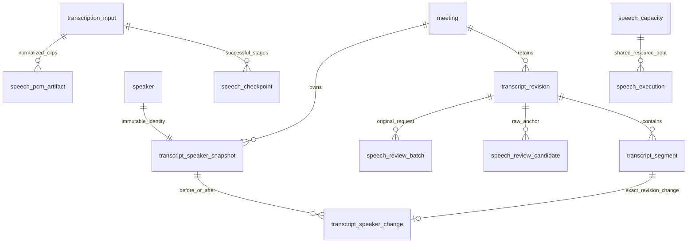
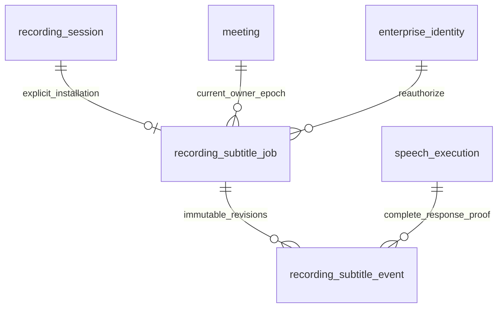
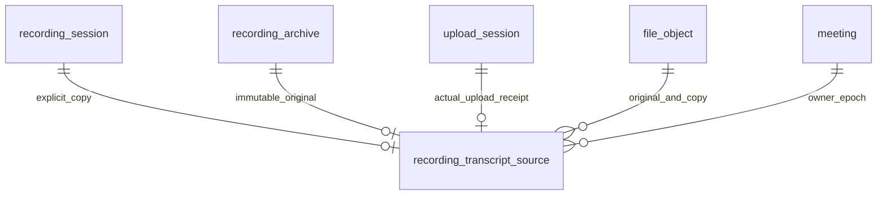

> 2026-11-02当前状态：正常主库已应用V060，50条SQL迁移均success=1；字幕job/event与独立录音转写来源三表59列实际只读核验通过，冻结V060源码SHA未变。证据`.tools/local-app/bcd-completion/bcd-final-database-readonly/report.json`，登记见migration-register.md末尾。本页下方“主库仍058/059、尚未应用”属于设计/初次验证历史，不覆盖本条；两小时与生产部署专属验证仍归F。

# 语音与人工核对增量数据字典和评审

当前增量范围为 V056—V059。本地 MySQL/受管文件；外部测试使用固定兄弟8792/2525，不由受控协议推断公司权威或模型质量。历史迁移不重写，已应用版本通过新增迁移演进。

| 表 | 主键及归属 | 关键字段和含义 | 约束与清理 |
| --- | --- | --- | --- |
| speech_capacity | service_key | total_slots / realtime_slots / offline_slots、config_revision；同一实际服务跨进程额度，不按profile复制池 | total≤100，实时和离线份额之和≤总额；当前harness66/64/2，不代表公司配额 |
| speech_execution | id；service_key FK | scope_sha256、lane、path、request/response_sha256、state、lease_task_id/attempt/owner_sha256、created_at/settled_at | 仅摘要资源事实；UNKNOWN不因超时、租约过期、404或meeting删除而结算。完整响应或provider可核验证据才释放；不存音频/识别文本 |
| speech_checkpoint | input_id,clip_key,stage | file_id、原/PCM/engine SHA、样本范围、真实task/attempt、payload及其SHA | 每stage成功输出不可覆盖；payload≤1MiB；5种stage；归属input/task；meeting删除物理清理 |
| speech_pcm_artifact | id；input_id,clip_key唯一 | meeting/input/task/file归属、原SHA/PCM SHA/engine SHA、source_samples和clip范围、backend/namespace/object_key、WAV SHA/字节数、RESERVED/READY | 先提交专用键意图再物理I/O；clip≤120秒、source≤2小时；byte_count=44+2*sample_count；删除包括RESERVED并永久retireKey |
| speech_review_candidate | id；RAW/segment唯一 | meeting/raw/created-working/input/segment/file/clip/engine、ASR/PUNC SHA、before/after_text、state、decision/undo_revision、creator/time | 来源固定为真实成功checkpoint；每RAW≤60；PENDING/ACCEPTED/REJECTED/UNDONE/STALE；接受/拒绝/撤销跟随新WORKING原事务；删除先于segment/file/revision |
| speech_review_batch | id；scope_sha256唯一 | request_sha256、meeting/source_revision、expected_revision、actor、candidate_ids、created_count | 沿无FK idempotency_record先claim后根锁；已受理批次先于新模型/档案能力恢复，不回挂历史稿；meeting删除清理 |
| transcript_speaker_snapshot | id（FK speaker.id） | meeting_id、label≤256字符、nullable enterprise_id、HUMAN、payload_sha256 | 不可变人工标签；digest绑定版本ID/meeting/原始标签/关联ID；每次改名/合并新ID，旧speaker镜像字段必须逐项相同；无自动实名/ACL作用 |
| transcript_speaker_change | revision_id,segment_id | before_speaker_id、after_speaker_id，可空；两个非空ID均FK snapshot | 只记录实际变化；绑定真实WORKING和具体segment；before/after不得相同；RAW不允许该证明或非空speaker；删除先于snapshot/segment |

| recording_subtitle_job | id；session_id唯一FK | 当前meeting/owner/cancel_epoch、part/seq/样本游标、窗口修订、事件和文本预算、LEASED attempt/owner/expiry、next_run/error | 每录音一个技术job；仅连续已ACK PCM；租约20秒；状态IDLE/LEASED/DELAYED/DEFERRED/DONE/CANCELLED；≤9232事件/32MiB文本，不扩大录音限额 |
| recording_subtitle_event | session_id,event_no；job/meeting/execution FK | 不可变segment/revision1—3、temporary/stable、真实文本SHA/输入指纹/engine SHA、原part/seq与绝对时间 | 每页≤64；读不创建job；稳定尾段重新核对源证明；删除先event再job/session，speech_execution摘要资源债务保留 |

V058已经在独占测试库 `ama_c_recording_5a8a2ff99e9a` 应用，SHA-256 `d062609f8e7c2218b682a01477509cce0a759af29d12d07f86afdb5fe97f52d4`，不得改写。主库当时V057；实际后续部署状态另记执行台账。首次真实标注/改名/旧标签回读/撤销/确认/MySQL权限保持用例通过；进一步HTTP/多片段/并发/损坏/企业身份/物理删除和完整源图回归仍按实际测试报告签收。

集中审查规则：请求不接受任意speakerId，只接受显式片段选择和人工label；现有speaker表仅新插入不可变镜像，不改旧行；S/F完整图、纪要来源图及核心stored facts都核对snapshot和精确变化证明。原confirmation-v1已包含speakerId，旧hash字节不改；新标签ID变化自然形成不同确认。源文件/原SHA/时间/段序仍与父稿一致，不能凭说话人标注改来源。可选enterpriseId只作为人工关联，在写入根前以规范顺序锁定并重验ACTIVE，绝不写meeting_access_grant/transcript_speaker_access。原键恢复不重新标注、不回挂历史稿。旧二进制无法验证新归属证明时应拒读；产生新speaker版本后不承诺直接降级旧应用，此部署回滚边界留F显式验证。

V059 SHA `8afe136f26fa896f358bb3703cde543983c25a865c4d57a859b0a9649759760e` 已应用独占测试库 bf39889988a8；禁止改已应用脚本。主库部署前仍V058。字幕session_id列必须匹配既有parent utf8mb4_0900_ai_ci；其他新增UUID仍ascii_bin。

录音物理删除：recording_chunk的V055代数触发器更新session，不能使用同语句读取session的DELETE子查询。已删除根事务内先当前锁定真实所属session，再按该绑定ID有界DELETE500；不会跟随任意外部session。实际含PCM/job/event的删除回归覆盖该路径。

V060 `recording_transcript_source`（仅新独占测试库已应用，主库仍059）：SHA `54fd3408912dbe5bd3c9d73fce68277696be4e0d58ace17ce09ae652cb9743cf`。id主键，session/真实archive各自唯一；meeting/owner/cancel_epoch和original_file/source_sha/source_bytes/source_samples固定绑定原完成归档。upload_id和copy_file_id分别FK真实上传会话/文件；PENDING/LEASED/DELAYED/READY/CANCELLED；30秒租约、同attempt/owner更新，每part重新授权/续租，最多两分钟复制，分片≤8MiB。READY需要真实COMPLETED的TRANSCRIPT_INPUT upload、真实AVAILABLE副本以及与归档完整SHA/EOF/长度一致；原归档和副本独立fileId，不假造上传来源。大小≤230400044、样本≤115200000，source_bytes=44+2*source_samples；随meeting在archive/file/upload parents之前清理。

独立`ama.recording-wav.v1`/`ama.import-recording-wav.v1`档案配置声明两小时WAV，不改v3档案字节。intake准备和reserve、Worker实际TASK_PREPARATION/TASK_MUTATION的S/F门禁都重验真实READY副本证明；普通同字节文件没有此能力。Worker Settings普通aggregate不放大，新增独立recordingSourceBytes（旧四参数构造默认0禁用）；只有录音profile才消费此上限。FFmpeg默认三参数Limits仍≤32MiB，显式recording容量入口本身不授予业务权限。
