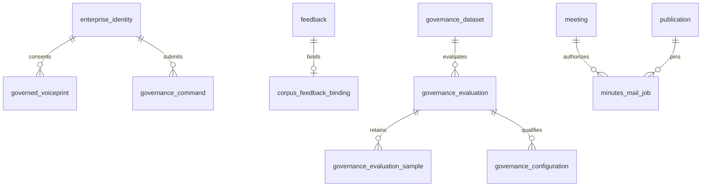

# V062治理与邮件增量字典

迁移只追加新表，既有反馈、会议与身份模型不变。表的完整列、类型、FK和CHECK以不可改写的V062 SQL为准。

| 表 | 主键／唯一性 | 用途与生命周期 |
| --- | --- | --- |
| corpus_feedback_binding | feedback_id，FK feedback | 原反馈源会议修订及显式段ID；withdrawn立即停止消费，会议删除前先清除此子行 |
| governance_command | scope_hash=actor/operation/original-key SHA256 | 不可变原请求摘要/结果；不存Cookie/CSRF。当前身份与角色始终复核，历史回执不重放业务 |
| governed_voiceprint | id，subject FK enterprise_identity | 本人同意凭据、候选用途、期限、状态、修订、模型版本/维度、样本SHA/长度。无原音频；AES-256-GCM向量随机nonce、资源/主体/版本/维度AAD绑定；撤销/拒绝/到期清除密文 |
| governance_dataset | id；version UNIQUE | 管理员明确提供的不可变评测样本与内容SHA；不自动收集任意会议全文或用于训练 |
| governance_evaluation | id；dataset FK；actor FK | 固定配置JSON，PENDING/RUNNING/COMPLETED/CANCELLED、租约、人工复核意见；已受理任务不随全局回滚改快照 |
| governance_evaluation_sample | (run_id,sample_id) | 每样本机器结果，失败/超时保持在总样本分母；任务重启复用已落库结果 |
| governance_configuration | revision；evaluation FK | 完整配置、审核评测、发布者、原因、rollback_of；回滚创建新修订，不改历史。初始阈值null，匹配关闭 |
| minutes_mail_job | id；meeting/publication/actor FK | source_revision、排序收件ID、执行请求、PENDING/UNKNOWN/SENT/FAILED/BLOCKED、租约与查询时间。UNKNOWN在任何首发网络之前提交；重启只查询原业务键 |

治理角色不授予会议ACL；候选匹配不改ACL。语料消费要求批准、未撤回、源版本一致、来源有效及提交者仍ACTIVE且有源权限；旧未绑定反馈不投入语料。邮件仅原负责人对当前ACTIVE且获正式授权的企业人员发送受鉴权链接，不保存或发送会议正文/附件。

本地主密钥在受限0600文件，由启动器首次随机生成，不写进仓库/接口/审计。业务元数据和审计保留；向量撤销后的备份/密钥轮换与部署恢复处理保留在F，不能把在线清理声称备份物理清理。评测样本仅管理员明确授权输入，真实公司数据保留规则另由企业落地。

V063增量：governance_dataset.sample_count是JSON_LENGTH(samples_json)的STORED生成列，CHECK为1—50；operations_dataset_history(created_at,id)用于有界倒序元数据列表。避免排序时搬运大音频JSON，不增加服务器sort buffer。原数据集和内容SHA保留。
