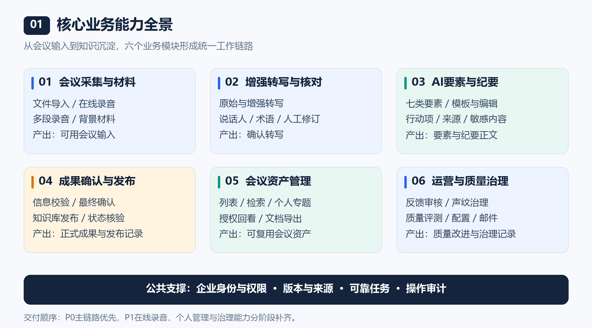
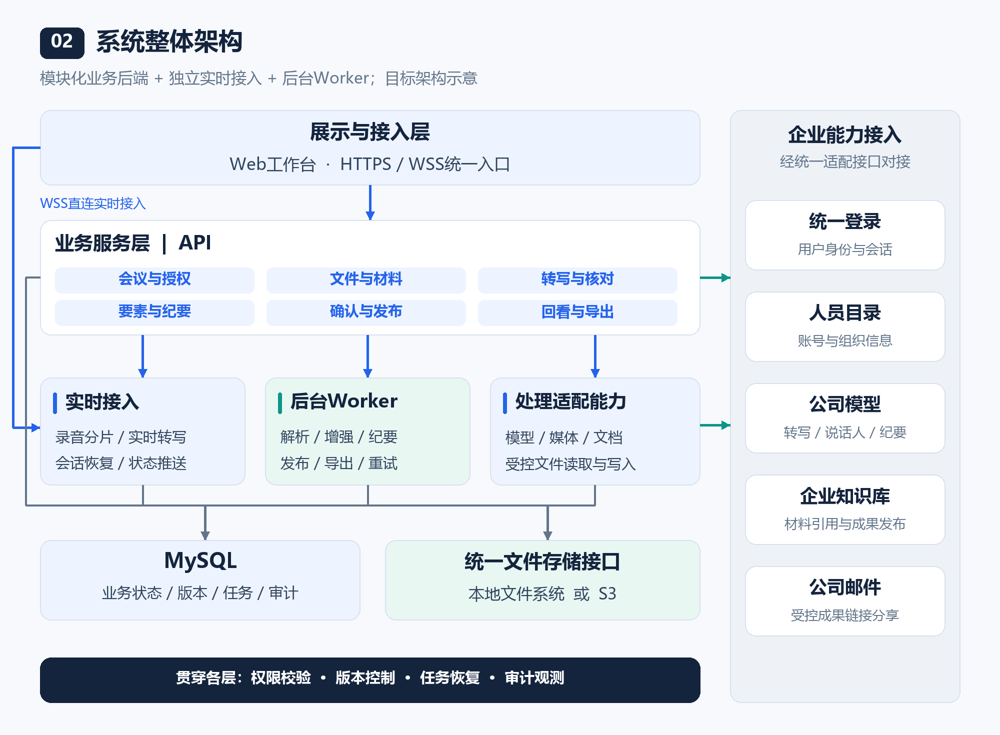
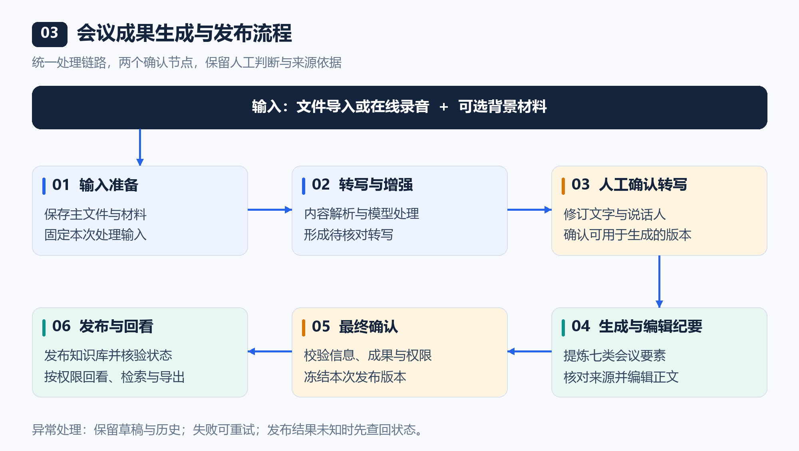
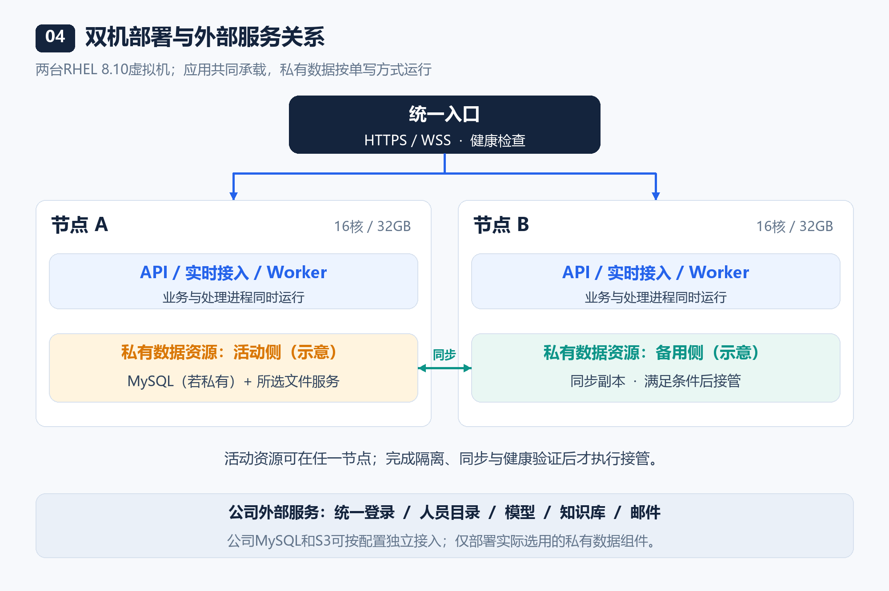
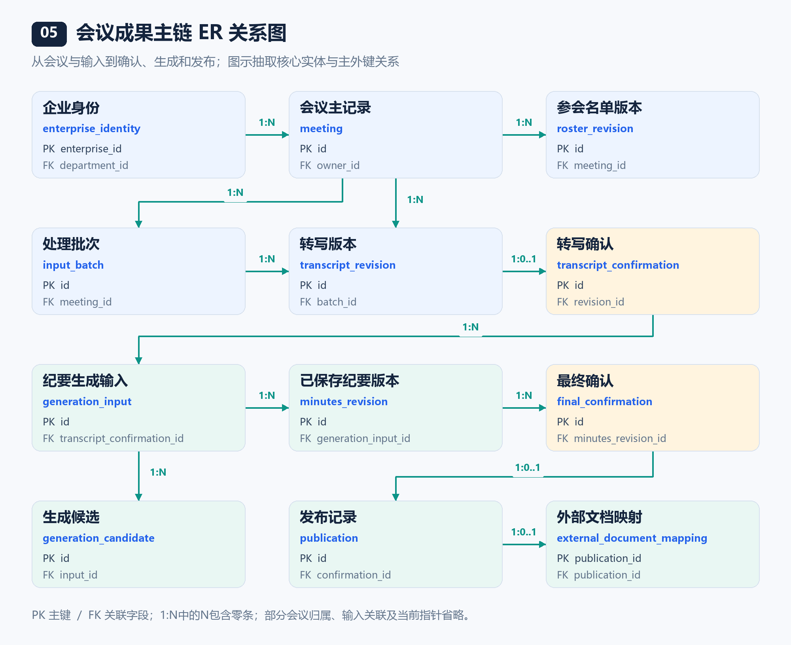
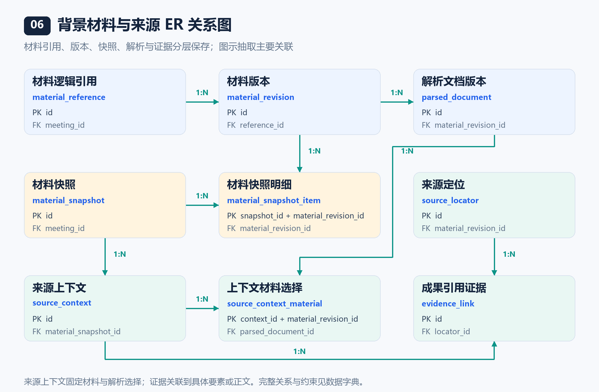
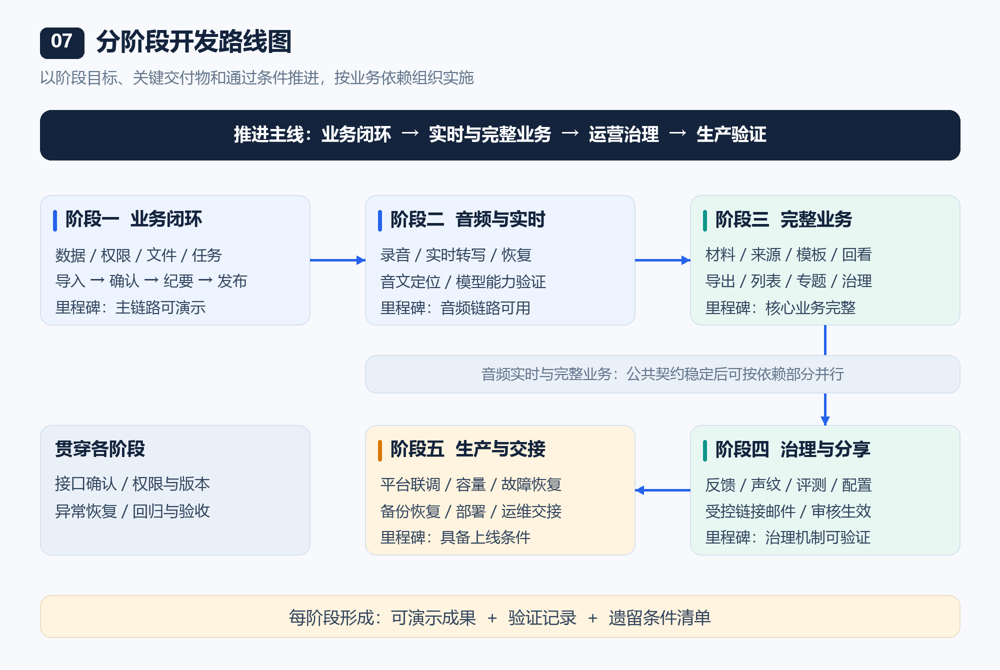

# 企业智能会议助手项目简要方案

> **内部评审会议稿** · 2026年10月26日  
> **汇报主线：**核心业务能力 → 整体架构 → 技术取舍 → 数据模型 → 分阶段交付  
> **方案口径：**依据项目需求、架构与数据库设计整理；开发计划仅说明阶段目标、交付物和通过条件。

**项目定位：**面向企业内部会议场景，复用公司现有模型、统一登录、人员目录和知识库能力，形成“采集—核对—生成—确认—发布—回看”的业务闭环，将会议内容沉淀为有来源、可确认、按权限复用的知识资产。

| 评审关注 | 本方案回答的问题 |
| --- | --- |
| 业务价值 | 建设哪些核心能力，如何减少人工整理与成果流转成本 |
| 架构可行性 | 如何在双机条件下组织业务、实时处理、数据存储与企业集成 |
| 技术合理性 | 为什么采用当前技术路线，哪些组件需要验证后定型 |
| 数据完整性 | 如何组织业务表、版本与来源关系，支撑确认、发布和追溯 |
| 交付可控性 | 分阶段交付什么，以什么条件进入下一阶段 |

**阅读导航：**[1. 功能概要设计](#1-功能概要设计) · [2. 架构设计](#2-架构设计) · [3. 技术选型](#3-技术选型) · [4. 数据库设计](#4-数据库设计) · [5. 开发计划](#5-开发计划)

---

## 1. 功能概要设计

### 1.1 建设目标与业务价值

项目围绕会议内容整理和企业知识沉淀，解决三个主要问题。

| 当前问题 | 建设方向 | 预期业务价值 |
| --- | --- | --- |
| 录音整理耗时，关键信息依赖人工反复查找 | 自动转写、背景材料增强、人工集中核对 | 缩短整理链路，把人工精力集中到内容判断 |
| 决策、行动项与待确认事项分散在长文本中 | 结构化提炼会议要素，保留来源依据 | 提高会议成果的可读性和后续跟进便利性 |
| 会议成果分散，发布与访问边界不统一 | 统一确认、知识库发布、授权回看与版本记录 | 形成可追溯的知识资产，提高内部复用效率 |

**价值评估方向：**会议整理耗时、转写与纪要质量、人工修订量、发布成功情况及成果复用情况。具体量化标准在测试样本和试用范围确定后形成。

### 1.2 用户角色与职责

- **会议负责人：**组织采集与材料准备，核对转写、编辑纪要，完成成果确认和发布。
- **已确认参会人：**在授权范围内回听录音、查看转写、纪要及相关材料。
- **运营与管理人员：**按职责处理反馈审核、质量评测、配置和任务异常；管理权限与会议内容访问权限分别控制。

### 1.3 核心能力全景

*图1：六个业务模块覆盖会议全生命周期，权限、版本、任务和审计贯穿各环节。*

| 主要模块 | 核心业务能力 | 主要业务产出 |
| --- | --- | --- |
| **会议采集与材料准备** | 文件导入、在线录音、多段录音管理；上传或引用知识库背景材料 | 会议草稿、主文件与材料集合 |
| **增强转写与人工核对** | 原始与增强转写、说话人管理、术语纠错、音文定位、修订与确认 | 可回听、可核对的确认转写 |
| **AI要素与纪要** | 七类要素提炼、行动项整理、模板生成、正文编辑、来源追溯和敏感内容处理 | 结构化要素、纪要正文及来源依据 |
| **成果确认与发布** | 会议信息与成果校验、最终确认、知识库发布、状态核验及发布治理 | 已确认成果、知识库文档及发布记录 |
| **会议资产管理** | 会议列表、搜索筛选、个人专题、授权回看、文档导出 | 可检索、可回看的会议资产 |
| **运营与质量治理** | 语料反馈、声纹治理、质量评测、系统配置和受控邮件分享 | 审核记录、质量报告及有效配置 |

七类会议要素为：**概述、讨论、结论、行动、风险、待确认事项、分歧**。背景补充、敏感信息和关联材料作为辅助信息管理。

### 1.4 一期范围与关键业务原则

**一期范围：**P0核心链路优先形成可演示闭环，P1在线录音、个人管理、邮件与运营治理等能力分阶段补齐；优先级决定先后顺序。

1. **人工确认把关。**转写确认后才能生成纪要；重要结论与行动项需要核对来源，成果经最终确认后发布。
2. **保护人工成果。**重新增强或重新生成保留候选与历史，已有人工编辑不被迟到结果覆盖。
3. **版本与来源可追溯。**处理任务绑定提交时的材料版本，纪要与发布成果能够追溯到对应转写和材料。
4. **访问授权独立控制。**参会授权以已确认企业身份为准，AI姓名建议、声纹候选和行动项负责人不自动产生访问权。
5. **已发布成果只读。**回看绑定发布版本，撤回、废止等变化同步影响访问状态。

输入格式、文件大小、时长以及扫描件解析能力，以后续确认的能力矩阵为准。

---

## 2. 架构设计

### 2.1 整体架构与分层

采用**模块化业务后端＋独立实时接入与后台任务进程**。模块按业务职责划分，耗时任务与交互请求分别执行，统一维护业务状态、权限和版本。

*图2：业务服务负责组织流程，实时接入与Worker承担不同处理负载，企业能力经适配接口接入。图中为目标架构。*

| 层次 | 核心职责 | 主要组成 |
| --- | --- | --- |
| **展示与接入层** | 提供采集、核对、编辑和回看入口，统一安全接入 | Web端、HTTPS/WSS入口 |
| **业务服务层** | 管理会议全生命周期及业务规则 | 会议、材料、转写、纪要、发布、资产管理 |
| **处理执行层** | 承载实时会话与耗时处理，控制并发和失败恢复 | 实时接入进程、后台Worker、文件处理能力 |
| **数据存储层** | 保存业务事实、版本、任务和文件内容 | MySQL、本地文件系统或S3 |
| **企业能力接入层** | 适配外部接口、身份及服务能力差异 | 统一登录、人员目录、模型、知识库、邮件 |

### 2.2 核心业务流程

*图3：采集入口汇入统一处理链路，转写确认与成果确认构成两个人工把关节点。*

| 流程阶段 | 处理重点 | 完成标志 |
| --- | --- | --- |
| **采集与准备** | 保存主文件、录音及可选背景材料，会议信息可并行补充 | 本次处理输入可用 |
| **转写与增强** | 解析内容，结合背景材料增强，保留原始来源 | 形成待核对转写 |
| **核对与确认** | 人工修订文字、说话人及纠错事项，确认有效版本 | 形成确认转写 |
| **要素与纪要** | 提炼结构化要素，生成正文，核对关键结论和来源 | 形成已保存、待最终确认成果 |
| **确认与发布** | 补齐必要信息，校验成果与权限，提交知识库 | 发布状态得到确认 |
| **回看与复用** | 按权限提供录音、转写、纪要、来源及导出 | 有效版本可访问、可追溯 |

**异常处理原则：**保存失败保留草稿，任务失败提供可诊断原因和重试入口；外部发布结果未知时先查回状态，避免重复创建文档。

### 2.3 模块依赖关系

| 业务模块 | 主要依赖 | 依赖约束 |
| --- | --- | --- |
| 会议与授权 | 统一登录、企业人员目录 | 创建、编辑和回看均通过服务端权限校验 |
| 文件与材料 | 文件存储、知识库材料接口 | 任务使用固定的输入与引用版本 |
| 增强转写 | 采集文件、材料、模型服务 | 原始结果、增强候选和人工稿分别保留 |
| 要素与纪要 | 确认转写、有效材料、模板 | 生成输入有依据，重新生成保护人工稿 |
| 确认与发布 | 已保存成果、知识库目录及权限 | 发布绑定最终确认版本，重试可核验外部结果 |
| 回看与导出 | 会议授权、有效成果与文件服务 | 使用实际有权访问的版本，读取时复核权限 |

任务调度、审计和版本管理为公共支撑能力，各模块通过明确的业务接口协作。

### 2.4 部署拓扑与存储选择

部署基线为**两台RHEL 8.10虚拟机，每台16核、32GB内存**。两台应用共同承载请求；选用私有数据组件时，数据服务保持单活动写入并支持故障接管。

*图4：两台应用同时提供服务，私有数据资源按单写方式运行。活动资源可在任一节点，接管能力依赖隔离、同步和健康验证。*

数据库来源与文件存储方式独立选择，保持同一套业务逻辑。

| 配置维度 | 可选方式 | 对项目的影响 |
| --- | --- | --- |
| **数据库来源** | 两台内私有MySQL／公司MySQL | 决定数据库高可用、备份和运维责任归属 |
| **文件存储方式** | 服务器本地文件系统／S3兼容存储 | 决定文件服务及存储运维方式 |
| **S3来源** | 私有S3／公司S3 | 仅在选择S3时适用；私有产品通过兼容性及恢复验证后定型 |

本地文件模式采用活动文件服务与受保护数据卷；S3模式通过统一存储接口接入。更换默认写入后端时，历史文件仍按原记录读取，在途录音和上传保持原后端。

### 2.5 关键非功能目标

| 关注点 | 目标或设计原则 | 主要验证方式 |
| --- | --- | --- |
| **使用规模** | 面向约1000名企业内部用户 | 试用范围与业务场景确认 |
| **并发能力** | 100场同时录音并实时转写，合计300名在线用户；300包含录音用户 | 应用协议负载与真实模型容量联合验证 |
| **可靠性** | 保存状态真实可核验，任务可恢复，私有模式支持单节点故障接管 | 故障注入、数据核对与恢复演练 |
| **内容一致性** | 任务、人工编辑、确认和发布使用明确版本 | 并发编辑、迟到结果及重试场景验证 |
| **权限与审计** | 会议、来源材料和成果访问分别校验，关键操作可追踪 | 越权、撤权、发布失效及审计场景验证 |

容量与恢复能力将在真实环境中通过负载测试、故障演练和数据核对验收。

---

## 3. 技术选型

### 3.1 总体路线取舍

| 架构路线 | 主要收益 | 主要代价 | 本项目结论 |
| --- | --- | --- | --- |
| **模块化后端＋独立实时／任务进程** | 业务事务清晰，重任务隔离，统一开发维护 | 需管理进程间契约和任务恢复 | **沿用已确认基线** |
| 全面微服务化 | 服务可独立发布和扩容 | 双机环境中的部署、链路和一致性管理成本较高 | 暂不作为一期路线 |
| 单进程承载全部能力 | 初期搭建简单 | 实时录音、解析、模型任务与API共享资源和故障影响 | 不作为生产基线 |

选型重点是让一期具备清晰边界、可恢复流程和可维护部署，并为后续按瓶颈扩展保留接口。

### 3.2 核心组件与理由

| 领域 | 核心选型 | 选型理由与简要对比 |
| --- | --- | --- |
| **前端工程** | Vue 3、TypeScript、Vite、Vue Router | 适合核对、编辑和工作台场景；类型约束便于页面与接口协作 |
| **服务端** | Java 21、Spring Boot 4.x、Spring Security | 便于组织业务事务、权限和企业接口；在统一后端内保持模块边界 |
| **业务数据** | MySQL 8.4 LTS、Spring JDBC、Flyway | 支持事务、版本和任务状态；显式SQL便于审核关键一致性逻辑，迁移工具管理结构演进 |
| **文件存储** | 统一存储接口，本地／S3双实现 | 本地模式减少存储服务依赖，S3模式便于复用公司平台；业务不绑定具体供应方 |
| **可靠任务** | MySQL持久化任务、独立Worker | 支持排队、重试和恢复；相较独立MQ，一期组件更少，后续按负载证据评估扩展 |
| **模型与媒体处理** | 公司模型服务、受限FFmpeg及隔离解析进程 | 复用现有推理能力；媒体与文档处理独立执行，减少对业务请求的影响 |
| **部署与高可用** | Podman、systemd；私有HA候选为Pacemaker／Corosync＋DRBD | 适配双机环境，部署链路较Kubernetes精简；候选组合需通过实际环境验证 |
| **验证与观测** | JUnit、Playwright、结构化日志与指标 | 同时覆盖业务规则、完整用户流程和运行状态；支撑问题定位与阶段验收 |

**版本管理：**统一锁定依赖版本；生产发布前核对兼容性、企业镜像及安全要求。公司MySQL的版本与能力单独核验。

### 3.3 企业服务接入与定型条件

| 外部能力 | 项目侧职责 | 平台侧需明确的内容 |
| --- | --- | --- |
| **登录与人员目录** | 用户身份映射、会议授权、参会人选择 | 登录协议、稳定用户标识、停用与权限变更规则 |
| **模型服务** | 任务编排、输入输出适配、来源核对与质量反馈 | 实际支持格式、时间戳与说话人能力、吞吐配额、限流和失败语义 |
| **知识库** | 材料引用、最终成果发布、状态核验和治理同步 | 文件版本、访问权限、发布幂等或可靠查回、撤回／废止能力 |
| **邮件服务** | 发送有权限的受控成果链接 | 发件授权、收件范围、发送配额和结果查回能力 |

**定型原则：**模型质量与吞吐通过真实样本验证；私有存储与高可用组合通过恢复演练后确定；一期不将Redis、独立消息队列、搜索集群或Kubernetes设为必需依赖。

---

## 4. 数据库设计

### 4.1 数据模型设计思路

数据库以**会议为业务主线，以版本、快照和来源关系保证成果可追溯**。业务状态、权限、任务与引用关系保存在MySQL；录音、材料原文件及导出文件保存在本地或S3存储，数据库登记文件元数据和关联。

| 设计要点 | 概要说明 | 支撑的业务目标 |
| --- | --- | --- |
| **会议主记录与内容版本分离** | 会议保存生命周期及有效版本引用，信息、转写、纪要分别记录历史 | 既能读取当前成果，也能追溯修改依据 |
| **名单与访问权限分离** | 名单保存参会信息，授权表保存实际生效的访问权 | 避免草稿、AI姓名或说话人候选误授权 |
| **输入快照与生成候选分离** | 生成绑定明确输入；候选与已保存正文分别管理 | 结果可复现，重新生成保护人工成果 |
| **材料、解析与证据分层** | 保留源材料版本、解析页段和成果引用关系 | 能从纪要定位到录音、转写或材料 |
| **确认与发布绑定** | 最终确认冻结版本集合，发布及重试引用该确认 | 避免内容漂移与重复发布 |
| **业务事实与执行记录分离** | 任务、执行尝试、外部结果及审计各有记录 | 支撑失败恢复、结果核验与问题追踪 |

### 4.2 表结构领域划分

概要模型按**8个领域、99张表**组织。表数量反映内容版本、关联明细、执行记录等职责拆分，业务讲解以领域和主链关系为主。

| 数据领域 | 表数量 | 主要管理对象 |
| --- | --- | --- |
| **身份、会议与访问** | 12 | 企业身份、会议主记录、信息版本、参会名单、授权及检索投影 |
| **文件、采集与媒体** | 15 | 存储后端、文件引用、上传分片、处理批次、录音和媒体时间轴 |
| **背景材料与来源** | 11 | 材料版本、材料快照、解析结果、来源上下文与引用证据 |
| **转写与人工编辑** | 8 | 处理输入、转写版本、片段、说话人、编辑与确认 |
| **纪要、要素与复核** | 18 | 模板、生成输入、要素、正文、敏感排除、候选与人工核对 |
| **成果发布与资产管理** | 14 | 最终确认、知识库发布、发布治理、导出、专题与邮件 |
| **运营治理与质量** | 9 | 反馈语料、声纹授权与样本、评测、配置与发布 |
| **任务、集成与审计** | 12 | 持久任务、外部调用、事件、模型额度及操作审计 |

### 4.3 核心ER关系图

**会议成果主链：**企业身份关联会议，会议组织输入与转写；确认转写作为生成依据，已保存纪要经最终确认后关联发布与外部文档。

*图5：抽取主链实体与关键关联。PK为主键，FK为关联字段；1:N表示一对多且子记录可为零条，1:0..1表示可选的一对一关系。为便于讲解，省略部分所属会议关系及当前版本指针。*

**材料与来源链：**材料逻辑引用产生具体版本，材料快照固定使用范围；解析版本、来源定位和证据关联共同支撑成果溯源。

*图6：材料快照与材料版本通过明细表关联，来源上下文固定具体解析版本，引用证据关联到要素或正文。图示选取主要关系，完整关系以数据库详细设计为准。*

**关键关系解释**

| 业务关系 | 关联方式 | 业务含义 |
| --- | --- | --- |
| 会议与参会人 | `roster_revision`＋`roster_member`组织名单；`meeting_access_grant`另行授权 | 名单可以修订，授权只依据明确确认的有效身份 |
| 处理批次与文件 | `input_batch_file`关联`input_batch`与`file_object` | 一个批次包含多个有序文件，输入范围可核对 |
| 转写版本与确认 | `transcript_confirmation.revision_id`引用已保存转写 | 同一保存稿最多形成一条确认记录，确认后的版本成为生成依据 |
| 材料快照与版本 | `material_snapshot_item`连接快照与材料版本 | 同一材料版本可被多个快照复用，每次处理使用固定集合 |
| 模板与版本 | `minutes_template`关联多个`template_revision` | 模板名称与逻辑身份稳定，历史生成保留实际使用版本 |
| 要素、来源与复核 | `evidence_link`关联要素或正文与来源；`result_review`记录人工判断 | 引用可追溯，人工核对绑定精确目标与证据集合 |
| 会议与发布 | 每场会议一个`publication`发布根，受理和尝试另表记录 | 失败重试有完整历史，成功文档通过唯一映射关联 |
| 专题与会议 | `meeting_topic`连接`topic`与`meeting` | 专题用于个人归集，不改变会议权限或成果版本 |

### 4.4 逐表概要结构与业务作用

以下按领域展开全部99张表，每张表仅列业务相关的关键字段及作用。字段类型、完整约束、索引和迁移策略保留在详细数据字典中；部分明细表采用复合主键。

会议讲解可先展示领域概览与ER图，需要核对具体表时展开对应领域。

<!-- DB_CATALOG_START -->

<strong>1. 身份、会议与访问（12张表）</strong>

| 表名 | 概要字段 | 业务作用 |
| --- | --- | --- |
| `department` | `enterprise_id`、`parent_id`、`display_name` | 保存企业部门及上下级关系，支撑人员目录展示。 |
| `enterprise_identity` | `enterprise_id`、`department_id`、`display_name`、`status` | 保存企业账号投影及有效状态，作为负责人和参会人的身份依据。 |
| `role_assignment` | `enterprise_id`、`role` | 记录平台管理角色，管理职责与会议正文访问权分开。 |
| `identity_session` | `token_hash`、`enterprise_id`、`expires_at`、`revoked_at` | 管理登录会话、有效期与撤销状态。 |
| `meeting` | `id`、`owner_id`、`stage`、`lifecycle` | 保存会议主记录、唯一负责人和业务生命周期，关联各环节有效版本。 |
| `meeting_info_revision` | `id`、`meeting_id`、`name`、`actual_meeting_date` | 保留会议名称、分类、摘要和实际日期的历史版本。 |
| `roster_revision` | `id`、`meeting_id`、`revision`、`state` | 区分名单草稿与已确认名单，保存名单版本。 |
| `roster_member` | `roster_id`、`member_id`、`enterprise_id`、`display_name` | 保存某一名单版本的成员内容，名单本身不直接授权。 |
| `meeting_access_grant` | `meeting_id`、`enterprise_id`、`action`、`roster_id` | 保存会议实际生效的用户访问权限及其名单依据。 |
| `info_suggestion` | `id`、`meeting_id`、`proposed_info`、`state` | 保存AI提出的会议信息建议及采纳状态。 |
| `meeting_search_projection` | `meeting_id`、`name_search`、`number_search`、`category_id` | 提供会议列表的名称、编号和分类检索数据。 |
| `meeting_person_search` | `meeting_id`、`roster_id`、`member_id`、`name_search` | 提供已确认参会人姓名检索，排除草稿和AI候选。 |

<strong>2. 文件、采集与媒体（15张表）</strong>

| 表名 | 概要字段 | 业务作用 |
| --- | --- | --- |
| `storage_backend` | `id`、`storage_type`、`status`、`config_revision` | 注册本地或S3存储后端及配置版本，凭证由外部配置管理。 |
| `file_object` | `id`、`meeting_id`、`backend_id`、`object_key`、`sha256` | 登记受管文件的位置、归属和完整性信息，文件内容保存在存储后端。 |
| `file_reference` | `file_id`、`owner_kind`、`owner_id`、`purpose` | 记录各业务对象对文件的使用关系，支撑安全清理。 |
| `upload_session` | `id`、`meeting_id`、`backend_id`、`state`、`completed_file_id` | 管理固定存储后端的上传会话、恢复与完成状态。 |
| `upload_part` | `upload_id`、`part_no`、`size_bytes`、`sha256` | 保存上传分片及校验结果，支撑断点续传。 |
| `file_cleanup` | `id`、`file_id`、`state`、`attempt` | 登记文件删除和无引用文件清理，保留失败重试状态。 |
| `input_batch` | `id`、`meeting_id`、`kind`、`input_fingerprint` | 冻结一次正式处理的主文件批次与输入摘要。 |
| `input_batch_file` | `batch_id`、`ordinal`、`file_id`、`sha256` | 保存批次内文件顺序及内容校验，关联批次与文件。 |
| `input_batch_fingerprint_profile` | `batch_id`、`profile` | 记录批次输入摘要使用的算法规则，保证历史输入可解释。 |
| `media_source` | `id`、`batch_id`、`normalized_file_id`、`sample_count` | 保存标准化音频及采样信息，作为媒体处理依据。 |
| `media_source_span` | `media_id`、`source_file_id`、`source_start_sample`、`global_start_sample` | 记录原录音与合并音频之间的时间轴对应关系。 |
| `recording_session` | `id`、`meeting_id`、`backend_id`、`state` | 管理在线录音会话、采集者和固定存储后端。 |
| `recording_part` | `id`、`session_id`、`ordinal`、`highest_contiguous_seq` | 管理录音分段顺序和已连续保存范围。 |
| `recording_chunk` | `part_id`、`seq`、`file_id`、`sha256` | 记录已保存录音分片及完整性，作为保存确认依据。 |
| `subtitle_revision` | `session_id`、`segment_id`、`revision`、`state` | 保留临时与稳定字幕版本，与正式确认转写分开。 |

<strong>3. 背景材料与来源（11张表）</strong>

| 表名 | 概要字段 | 业务作用 |
| --- | --- | --- |
| `material_reference` | `id`、`meeting_id`、`kind`、`external_id`、`file_id` | 保存会议对本地或知识库材料的逻辑关联。 |
| `material_revision` | `id`、`reference_id`、`external_version`、`content_hash` | 固定材料的具体源版本与内容，避免随源文件更新而变化。 |
| `material_snapshot` | `id`、`meeting_id`、`revision`、`input_fingerprint` | 冻结本次明确应用的材料集合。 |
| `material_snapshot_item` | `snapshot_id`、`material_revision_id`、`ordinal` | 记录材料快照包含的具体材料版本及顺序。 |
| `parsed_document` | `id`、`material_revision_id`、`parser_version`、`state` | 记录材料解析版本、结果与失败状态。 |
| `parsed_unit` | `document_id`、`ordinal`、`page_no`、`paragraph_no`、`body` | 保存解析文本及页码、段落等定位信息。 |
| `parsed_document_profile` | `document_id`、`format`、`parser_config_version` | 固定解析格式和配置规则，支撑结果复现。 |
| `source_context` | `id`、`meeting_id`、`generation_input_id`、`material_snapshot_id` | 冻结一次生成或人工选源时的完整来源范围。 |
| `source_context_material` | `context_id`、`material_revision_id`、`parsed_document_id` | 明确来源上下文中每份材料使用的解析版本。 |
| `source_locator` | `id`、`kind`、`segment_id`、`material_revision_id`、`page_no` | 定位转写片段、录音范围或材料页段。 |
| `evidence_link` | `id`、`locator_id`、`element_id`、`minutes_revision_id` | 将具体要素或正文内容关联到可核对的来源证据。 |

<strong>4. 转写与人工编辑（8张表）</strong>

| 表名 | 概要字段 | 业务作用 |
| --- | --- | --- |
| `transcription_input` | `id`、`meeting_id`、`batch_id`、`material_snapshot_id` | 冻结导入、识别或重新增强的输入与配置。 |
| `transcript_revision` | `id`、`meeting_id`、`kind`、`parent_id`、`processing_input_id` | 区分原始、增强、人工与候选转写，保留版本关系。 |
| `transcript_segment` | `revision_id`、`segment_id`、`body`、`speaker_id` | 保存转写片段正文、说话人和来源定位。 |
| `transcript_confirmation` | `id`、`meeting_id`、`revision_id`、`confirmed_by` | 冻结人工确认的已保存转写，作为纪要生成依据。 |
| `transcript_segment_mark` | `revision_id`、`segment_id`、`mark` | 保存与具体转写版本绑定的片段标记。 |
| `speaker` | `id`、`meeting_id`、`display_name`、`enterprise_id` | 管理说话人标签与身份对应，独立于会议访问授权。 |
| `correction` | `id`、`revision_id`、`segment_id`、`state` | 保存针对具体转写片段的纠错建议与处理状态。 |
| `edit_operation` | `id`、`meeting_id`、`before_revision_id`、`after_revision_id` | 记录编辑与撤销操作，保留修改前后版本关系。 |

<strong>5. 纪要、要素与复核（18张表）</strong>

| 表名 | 概要字段 | 业务作用 |
| --- | --- | --- |
| `minutes_template` | `id`、`owner_id`、`name`、`current_revision_id` | 管理模板逻辑身份、归属和当前版本。 |
| `template_revision` | `id`、`template_id`、`revision`、`themes` | 保存内置或个人模板的历史版本与生成主题。 |
| `generation_input` | `id`、`meeting_id`、`transcript_confirmation_id`、`material_snapshot_id` | 冻结纪要生成使用的确认转写、材料、模板和相关设置。 |
| `element_set` | `id`、`meeting_id`、`revision` | 管理七类会议要素集合的独立版本。 |
| `minutes_element` | `id`、`set_id`、`category`、`body` | 保存结构化会议要素及其类别、内容和来源上下文。 |
| `action_item` | `element_id`、`owner_enterprise_id`、`owner_display`、`due_on` | 保存已编辑的行动项负责人和截止日期。 |
| `action_suggestion` | `element_id`、`input_id`、`owner_mention`、`due_on` | 单独保存模型提出的负责人及日期建议，等待核实。 |
| `minutes_revision` | `id`、`meeting_id`、`title`、`body`、`generation_input_id` | 保存纪要标题和正文的历史版本及生成来源。 |
| `generation_candidate` | `id`、`input_id`、`minutes_revision_id`、`state` | 保存待采用生成结果，保护已有人工编辑。 |
| `exclusion_revision` | `id`、`meeting_id`、`revision` | 管理敏感排除设置的集合版本。 |
| `sensitive_exclusion` | `revision_id`、`locator_id`、`category`、`reason` | 记录明确排除的来源内容及原因，不删除原始会议资料。 |
| `sensitive_detection` | `id`、`set_id`、`input_id`、`category` | 保留敏感内容检测目录，供用户判断是否排除。 |
| `sensitive_detection_source` | `detection_id`、`locator_id` | 记录敏感检测项关联的完整来源集合。 |
| `background_note` | `id`、`set_id`、`input_id`、`body` | 保存辅助背景说明，并与会议发言和结论区分。 |
| `background_note_source` | `note_id`、`locator_id` | 记录背景说明对应的材料或转写来源。 |
| `result_review` | `id`、`meeting_id`、`review_kind`、`target_hash`、`outcome` | 记录人工对精确内容和来源集合的核对结论。 |
| `result_review_evidence` | `review_id`、`evidence_id` | 固定一次人工复核实际使用的证据集合。 |
| `meeting_minutes_editor_guard` | `meeting_id`、`intent_epoch` | 记录编辑意图的版本，防止生成结果覆盖正在进行的人工编辑。 |

<strong>6. 成果发布与资产管理（14张表）</strong>

| 表名 | 概要字段 | 业务作用 |
| --- | --- | --- |
| `final_confirmation` | `id`、`meeting_id`、`minutes_revision_id`、`transcript_confirmation_id` | 冻结最终确认的正文、转写、材料和相关版本集合。 |
| `final_result_review` | `confirmation_id`、`review_id` | 固定最终确认采用的人工复核记录。 |
| `publication` | `id`、`meeting_id`、`confirmation_id`、`state` | 管理会议发布根、目标位置和发布状态。 |
| `publication_submission` | `task_id`、`publication_id`、`confirmation_id`、`submission_no` | 绑定一次发布受理任务、确认版本和目标，保留受理历史。 |
| `publication_attempt` | `id`、`publication_id`、`operation_id`、`outcome` | 记录发布及结果查回的每次执行与结果。 |
| `external_document_mapping` | `publication_id`、`external_document_id`、`authority_state` | 建立本地成果与外部知识库文档的唯一映射。 |
| `publication_governance` | `id`、`publication_id`、`action`、`state` | 记录成果撤回、废止及其确认状态。 |
| `external_event_receipt` | `provider_id`、`event_id`、`payload_hash`、`processed_at` | 对外部状态事件去重，记录接收与处理情况。 |
| `export_job` | `id`、`meeting_id`、`format`、`output_file_id`、`state` | 管理绑定有效成果版本的Markdown、PDF或Word导出。 |
| `meeting_deletion` | `id`、`meeting_id`、`state`、`completed_at` | 记录会议删除申请、清理过程和完成事实。 |
| `topic` | `id`、`owner_id`、`name`、`description` | 管理个人专题的名称、说明和归属。 |
| `meeting_topic` | `topic_id`、`meeting_id` | 关联个人专题与符合归集条件的会议。 |
| `mail_job` | `id`、`meeting_id`、`minutes_revision_id`、`state` | 管理已保存成果的受控链接邮件发送任务。 |
| `mail_recipient` | `mail_job_id`、`enterprise_id`、`state`、`message_key` | 保存企业收件人、发送结果和查回标识。 |

<strong>7. 运营治理与质量（9张表）</strong>

| 表名 | 概要字段 | 业务作用 |
| --- | --- | --- |
| `corpus_feedback` | `id`、`meeting_id`、`category`、`state` | 管理会议语料反馈的提交、审核和处理结论。 |
| `feedback_segment` | `feedback_id`、`revision_id`、`segment_id` | 将反馈关联到精确转写版本和片段。 |
| `corpus_revision` | `id`、`feedback_id`、`content_file_id`、`purpose` | 保存审核通过的语料版本和允许用途。 |
| `voiceprint_consent` | `id`、`subject_id`、`purpose`、`state` | 记录声纹使用的明确授权、用途和撤销状态。 |
| `voiceprint_sample` | `id`、`consent_id`、`sample_file_id`、`state` | 管理与授权关联的声纹样本、模型信息和审核状态。 |
| `evaluation_dataset` | `id`、`version_key`、`manifest_file_id`、`purpose` | 登记受控评测数据集及版本。 |
| `evaluation_run` | `id`、`dataset_id`、`model_config_version`、`metrics` | 记录固定数据、模型和提示词条件下的评测结果。 |
| `configuration_revision` | `id`、`kind`、`revision`、`state` | 管理允许配置项的候选版本和审核状态。 |
| `configuration_release` | `id`、`configuration_id`、`evaluation_run_id`、`rollback_of_id` | 记录配置发布、评测依据及回滚关系。 |

<strong>8. 任务、集成与审计（12张表）</strong>

| 表名 | 概要字段 | 业务作用 |
| --- | --- | --- |
| `audit_event` | `id`、`actor_id`、`action`、`resource_id`、`result` | 记录关键操作主体、对象和结果，支撑追踪与审计。 |
| `idempotency_record` | `scope_hash`、`operation`、`key_hash`、`request_hash` | 识别重复业务请求并返回一致结果，阻止同键不同内容。 |
| `task_subject` | `subject_kind`、`subject_id`、`business_version`、`cancel_epoch` | 统一标记业务对象版本和取消状态，阻止旧任务回写。 |
| `durable_task` | `id`、`task_type`、`subject_id`、`state`、`attempt` | 保存后台任务、执行状态、重试和结果引用。 |
| `task_attempt` | `task_id`、`attempt`、`owner`、`outcome` | 记录每次Worker领取和执行的诊断历史。 |
| `external_operation` | `id`、`operation_kind`、`business_key`、`state` | 登记可能产生外部效果的业务操作及结果核验状态。 |
| `external_execution` | `id`、`operation_id`、`execution_no`、`state` | 保留同一外部业务操作下的追加执行记录。 |
| `task_outbox_sequence` | `id`、`next_id` | 管理持久事件的提交顺序，避免消费遗漏。 |
| `task_outbox` | `sequence_id`、`event_type`、`subject_id`、`reference_id` | 持久保存任务和业务变更事件的引用。 |
| `outbox_consumer` | `consumer_id`、`cursor`、`epoch`、`lease_owner` | 保存事件消费进度与接管状态。 |
| `model_capacity` | `model`、`capacity`、`config_revision`、`enabled` | 保存经配置确认的模型并发额度与启用状态。 |
| `model_reservation` | `id`、`model`、`execution_id`、`safe_deadline` | 记录在途模型调用占用，避免超时后额度重复释放。 |

<!-- DB_CATALOG_END -->

### 4.5 数据一致性与生命周期

| 控制点 | 概要设计 |
| --- | --- |
| **有效版本** | 当前有效稿由业务主记录引用，历史修订与候选分别保留 |
| **确认快照** | 转写确认、材料快照和最终确认绑定明确版本，后续修改不反向改变历史成果 |
| **并发编辑** | 业务版本与编辑意图共同校验，过期任务或迟到结果不能覆盖新稿 |
| **文件引用** | 受管文件统一登记引用，清理前核对使用关系，外部知识库材料仅解除会议关联 |
| **发布一致性** | 发布操作、受理任务、执行尝试和外部文档分层记录，未知结果进入核验流程 |
| **历史与删除** | 历史成果按业务规则保留；会议删除显式处理关联内容与文件，保留必要审计 |

---

## 5. 开发计划

### 5.1 推进策略与阶段边界

采用**先贯通核心业务闭环，再完善实时与完整业务，最后完成治理和生产验证**的推进方式。以阶段交付物和通过条件判断是否进入下一阶段。

- **业务闭环优先：**先实现转写文件导入、人工确认、纪要编辑和知识库发布。
- **依赖明确后并行：**音频实时能力与完整业务功能，在公共契约稳定后按依赖交叉推进。
- **平台能力提前确认：**身份、模型、知识库、邮件及部署条件作为配套准备事项持续落实。
- **验收贯穿开发：**每个阶段覆盖正常链路、权限、并发、失败和恢复场景。

### 5.2 阶段路线与里程碑

*图7：展示阶段顺序、依赖和交付目标。音频实时与完整业务可在公共契约稳定后部分并行。*

| 阶段 | 阶段目标 | 关键交付物 | 通过条件 |
| --- | --- | --- | --- |
| **阶段一：基础与业务闭环** | 建立数据、权限、文件及任务基础，贯通首条成果链路 | 数据模型与接口契约、文件与任务机制、转写确认、纪要编辑、测试知识库发布链路 | 转写文件导入到发布可演示，关键越权、冲突和失败场景可验证 |
| **阶段二：音频与实时能力** | 将录音和音频处理接入统一业务链路 | 音频处理、在线录音、实时转写、重连补传、音文定位 | 音频及实时链路可用，真实模型质量与并发能力满足对应目标 |
| **阶段三：完整业务与体验** | 补齐材料、成果管理和回看复用能力 | 背景材料、要素与来源、模板与版本、发布治理、回看、导出、列表与专题 | 一期核心业务与页面形成完整验收覆盖，来源、权限与版本规则一致 |
| **阶段四：运营治理与分享** | 建立质量改进、配置审核和受控分享能力 | 反馈审核、声纹治理、质量评测、配置管理、受控邮件分享 | 审核、生效、撤销和回滚规则可验证，相关企业服务联调通过 |
| **阶段五：生产验证与交接** | 验证完整系统的生产运行能力 | 平台联调报告、容量与故障恢复报告、备份恢复验证、部署包、运维手册 | 真实环境满足约定标准，完成上线评审与运维交接 |

### 5.3 交付与验收方式

每个阶段计划交付**可演示成果、验证记录和遗留条件清单**，分别组织以下验证。

| 验证层次 | 验证目标 | 计划交付 |
| --- | --- | --- |
| **实现验证** | 业务规则、状态流转、接口和失败处理符合设计 | 单元／受控集成测试、页面演示与流程记录 |
| **平台联调** | 与公司身份、模型、知识库及邮件服务实际协同 | 测试环境联调记录、接口契约与问题闭环 |
| **部署验收** | 双机环境中的容量、安全、故障恢复和运维能力成立 | 负载报告、恢复演练、备份恢复及交接记录 |

最终验收将覆盖完整会议链路、真实平台能力及目标部署环境，阶段性演示与最终生产验收分别评审。

### 5.4 关键依赖与实施安排

| 关键依赖 | 影响范围 | 计划安排 |
| --- | --- | --- |
| **模型质量与吞吐** | 转写增强、实时能力和容量目标 | 提前获取配额与样本，验证质量、响应和并发，再确定实时适配方案 |
| **知识库发布与查回** | 发布重试、去重和失效传播 | 在业务闭环阶段明确契约，联合验证超时、查回和重复提交场景 |
| **材料与来源能力** | 背景增强、证据定位和人工核对 | 固定材料与解析版本，联调引用权限、失效处理和来源定位 |
| **双机与存储条件** | 私有自动恢复和备份恢复 | 提前确认隔离、同步与底层存储条件，生产验证阶段执行故障演练 |
| **治理与邮件规则** | 反馈、声纹、配置和分享 | 在对应功能定型前明确用途、角色、审核及结果查回规则 |

### 5.5 本次评审建议确认事项

1. **范围与顺序：**确认六个业务模块及P0优先、P1分阶段补齐的交付顺序。
2. **数据模型：**确认领域划分、主要实体关系、版本与来源管理，以及发布和授权边界。
3. **交付边界：**确认各阶段目标、关键交付物、通过条件及允许并行的依赖关系。
4. **外部协同：**明确企业接口与部署条件的责任归属及提供条件。
5. **验收口径：**分别组织实现、平台联调和部署验收，容量及高可用以真实验证证据为准。

### 5.6 编制依据与配图说明

本文依据项目需求、架构、数据库设计与分阶段计划归纳，作为方案评审讲解材料。

- [智能会议助手一期需求说明](../../designDocs/智能会议助手一期需求说明文档.md)
- [整体架构v0.2](../superpowers/specs/2026-10-21-ama-architecture-design.md)
- [数据库详细设计](../superpowers/specs/2026-10-21-ama-database-design.md)
- [完整数据字典](../database/ama-data-dictionary.md)
- [分阶段交付计划](../superpowers/plans/2026-10-21-ama-delivery-plan.md)
- [产品决定与平台缺口台账](../contracts/product-decisions.md)

配图采用相对路径引用，PNG可直接用于Markdown预览；同目录保留SVG矢量源图、ER关系源文件和生成脚本。转发文档时请同时保留`assets/ama-project-brief/`目录。
