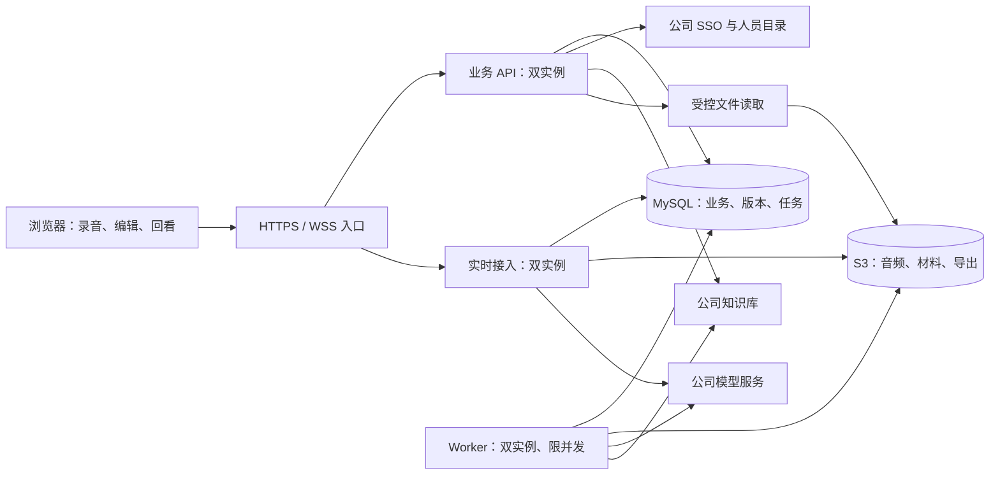
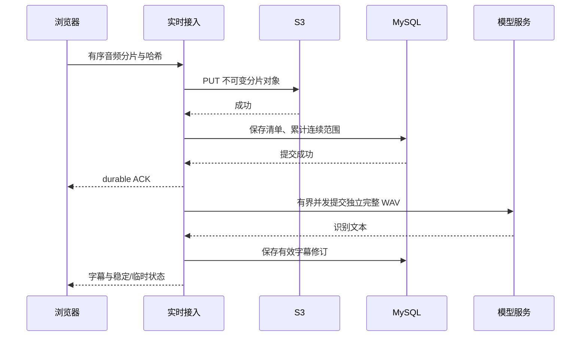

# 智能会议助手整体架构方案

日期：2026-10-21（北京时间）

版本：0.1，架构评审草案

状态：供用户评审；不是已完成的实现、压测报告或上线批准。

## 1. 建设目标与决策状态

面向约 1000 人的企业内部使用，完整实现会议采集、增强转写、人工核对、纪要生成、最终确认、知识库发布及回看。容量目标为 **100 场同时在线录音并实时转写，每场一个采集端，合计 300 名在线用户**。在线用户包含录音用户，不重复计数。

| 分类 | 已确认内容 |
| --- | --- |
| 主机 | 两台 RHEL 8.10 x86_64 虚拟机，每台 16 核、32GB 内存 |
| 私有模式 | 应用、MySQL、S3 兼容存储均在这两台内；不新增第三台项目节点 |
| 平台模式 | 两台运行应用，MySQL、S3 对接公司平台 |
| 故障恢复 | 私有模式需要自动恢复，不以人工确认切换作为正常故障处理方案 |
| 现有服务 | 模型、知识库、统一登录、企业人员目录均对接公司现有服务 |
| 待运维确认 | 虚拟化平台和隔离接口列为部署前置条件，不阻塞本轮架构设计 |
| 范围 | 原型与一期需求中的 P0、P1 都保留；优先级决定交付顺序，不代表删减 |

建议采用“模块化业务后端＋独立实时接入和任务进程”。本草案中的技术选型、数字化性能指标、对需求缺口的建议尚需评审；不能把用户确认的部署条件等同于批准全部细节。

设计依据：

- [一期需求](../../../designDocs/智能会议助手一期需求说明文档.md)：业务规则与权限依据。
- [1021 原型](../../../designDocs/智能会议助手1021版.html)：页面布局、视觉、操作入口依据。
- [模型接口](../../../designDocs/线上模型服务接口文档.md)：已知请求与响应格式依据。
- [需求对应与差异清单](2026-10-21-ama-requirements-matrix.md)：区分已有要求、冲突和补充建议。
- [部署前置条件](2026-10-21-ama-deployment-prerequisites.md)：记录负责人、证据和影响阶段。

发生冲突时，优先遵循用户最新明确指示；需求文档中的业务约束优先于原型模拟行为，原型负责视觉基准。需要新增或改变产品行为的事项进入差异清单，不能静默当作已确认需求。

## 2. 架构选择与技术基线

| 方案 | 收益 | 代价 | 本项目选择 |
| --- | --- | --- | --- |
| 模块化后端＋独立实时/任务进程 | 事务边界清楚，重任务隔离，同一仓库统一维护 | 需明确进程间契约与持久化任务协议 | 推荐 |
| 全面微服务化 | 模块独立发布和扩容 | 双机环境下部署、链路和一致性成本较高 | 一期不采用 |
| 全部集中一个应用进程 | 初期部署简单 | 音频、解析和请求处理共享故障与资源边界 | 不作为生产基线 |

| 层次 | 建议基线 | 约束 |
| --- | --- | --- |
| Web | Vue 3、TypeScript、Vite、Vue Router、Pinia | 原型设计令牌和专用组件优先，避免组件库默认样式改变 UI |
| 服务端 | Java 21、Spring Boot 4.x、Spring Security、Maven | 精确补丁版本在实施前按兼容性、企业镜像和漏洞检查锁定 |
| 数据访问 | Spring JDBC、显式事务、Flyway | 复杂版本校验和任务领取使用明确 SQL；迁移独立执行 |
| 数据库 | 私有模式 MySQL 8.4 LTS / InnoDB / utf8mb4 | 公司模式核实版本；最低能力包含事务、行锁、SKIP LOCKED，旧版本需重新评审 |
| 对象接口 | AWS SDK for Java v2 的 S3 API | Endpoint、寻址方式、Region、TLS、凭证全部可配置 |
| 私有对象存储 | 优先验证 SeaweedFS 稳定版本的 S3 服务 | 采用单活动服务组，HA 由下述同步卷与集群管理提供；须通过兼容性和持久化验证 |
| 音频/材料 | 受限 FFmpeg 子进程；隔离的文档解析进程 | 不在 API 进程内执行重解析；模型推理由公司服务承担 |
| 部署 | Podman、systemd；私有 HA 使用 Pacemaker、Corosync、DRBD 9 候选方案 | 受 HA 管理的服务只能有一个生命周期管理者 |
| 可观测性 | Micrometer、OpenTelemetry、Prometheus 格式指标、结构化日志 | 可接公司平台；无平台时提供双机内最小监控，不强制新增服务器 |

Spring 官方当前系统要求覆盖 Java 21，具体第三方依赖仍需兼容性验证。[Spring 文档](https://docs.spring.io/spring-boot/system-requirements.html)

私有 S3 选型说明：核查时 MinIO 社区仓库显示已于 2026-04-25 归档，故不将该归档分支默认作为新项目生产基线。SeaweedFS 提供 S3 网关和可选 MySQL Filer 元数据存储；这只说明接口和组件具备候选基础，不证明本项目的故障切换组合已经通过认证。若资格验证失败，调整存储实现并保持应用的 S3 契约，不静默降低自动恢复要求。[MinIO 仓库](https://github.com/minio/minio) · [SeaweedFS S3](https://github.com/seaweedfs/seaweedfs/wiki/Amazon-S3-API) · [Filer 存储](https://github.com/seaweedfs/seaweedfs/wiki/Filer-Stores)

一期不将 Redis、Kafka、RabbitMQ、Elasticsearch、向量数据库或 Kubernetes 设为必需依赖。数据库承担可靠任务与少量跨节点协调；1000 人的声纹候选检索可先在授权范围内计算。只有实测证实瓶颈且完成容量收益评审后再引入额外组件。

## 3. 逻辑架构与模块边界

进程分为 `ama-api`、`ama-realtime`、`ama-worker`，共享版本化的领域模块和协议。模块是代码和数据所有权边界，不等同于单独部署一个微服务。

| 模块 | 职责与主要契约 | 依赖 |
| --- | --- | --- |
| identity-access | 登录、企业 ID 映射、角色、会议 ACL、知识库权限适配 | SSO、人员目录、MySQL |
| meeting | 草稿、基本信息、名单草稿/确认、业务状态、列表 | identity-access |
| capture-file | 文件上传、校验、多段排序、录音会话、分片清单 | MySQL、S3 |
| material | 本地/知识库材料、解析、引用版本、材料集合快照 | capture-file、知识库适配器 |
| transcription | 原始/增强/人工转写、说话人、纠错、确认快照 | 模型适配器、material |
| minutes | 七类主体要素、敏感识别、来源、模板、正文和候选 | 确认转写、material |
| publication | 最终检查、确认快照、知识库发布、对账、撤回/废止同步 | minutes、知识库适配器 |
| organization-export | 个人专题、Markdown/PDF/Word 导出、邮件请求 | 会议授权、有效版本 |
| governance | 反馈审核、声纹治理、质量评测、配置与任务运维 | 明确管理范围、审计 |
| task-audit | 任务租约、重试、幂等、事件投递、审计 | MySQL |

API 模块不能绕过领域服务直接改其他模块的数据。实时与 Worker 仅持有完成其职责所需的数据库、S3 和模型权限。平台管理员权限不隐含会议正文访问权。

## 4. 两种部署模式

### 4.1 一套代码、两套部署配置

| 配置 | `private-ha` | `enterprise-platform` |
| --- | --- | --- |
| MySQL 地址 | 数据服务虚拟地址 | 公司数据库写入入口 |
| S3 地址 | 私有 S3 服务虚拟地址 | 公司 S3 地址 |
| 数据 HA 责任 | 项目部署包＋运维前置条件 | 公司平台 SLA 与恢复机制 |
| 应用进程 | 两台都运行 API、实时接入、Worker | 相同 |
| 业务表和接口 | 相同 | 相同 |
| 容量与故障验收 | 包括数据库、对象存储、同步复制成本 | 包括平台配额、延迟和故障行为 |

配置项覆盖数据库 TLS、连接池、S3 Endpoint/Region/Bucket/寻址方式、服务凭证、模型路由和超时、SSO/知识库协议。敏感配置通过受控文件或企业密钥服务注入，不进入前端、仓库或镜像。

数据库记录 `storage_backend_id + bucket + object_key + provider_version_id(可空) + sha256`，不持久化临时签名 URL。业务内容版本依赖不可变对象键，不依赖所有 S3 产品都实现原生对象版本功能。

上线前运行同一组数据库及 S3 契约测试：事务、锁、排序规则、PUT/HEAD/GET Range/DELETE、分页列举、分片上传/完成/中止、校验和、TLS、签名和错误语义。修改配置只改变连接目标；切换已有数据需要迁移、校验、切换窗口和回滚流程。

### 4.2 私有模式的物理拓扑

| 组件 | 节点 A | 节点 B |
| --- | --- | --- |
| HAProxy、静态前端 | 运行 | 运行 |
| API、实时接入、Worker | 运行并分担业务 | 运行并分担业务 |
| Pacemaker/Corosync | 集群成员 | 集群成员 |
| DRBD 数据卷 | 同步副本；最多一个 Primary | 同步副本；最多一个 Primary |
| MySQL、S3 服务组 | 资源组所在节点运行 | 非活动节点停止，等待接管 |
| 指标、日志代理 | 本机采集 | 本机采集 |

入口 VIP 当前由一个节点持有，该节点的 HAProxy 向两台应用分发；应用双活不要求入口 VIP 同时存在于两台。入口 VIP 和数据 VIP 由同一集群统一管理，不叠加独立脚本抢占。若企业已有合适负载均衡，可以替换入口组件，但不是私有模式默认新增的第三台项目节点。

数据层采用单写服务组：MySQL 与私有 S3 的所有持久化数据、索引和必要元数据必须纳入同步与恢复清单。SeaweedFS 候选拓扑为单活动 Master/Volume/Filer/S3 服务，Filer 使用同一 HA MySQL 的独立 schema；Master 状态、Volume 数据/索引以及持久化配置也必须受保护。不能只复制对象内容而遗漏索引，也不构造两个成员的 Master 多数派集群。

私有存储内部注册和访问使用切换后仍有效的稳定服务地址；不能把活动 VM 的临时地址永久写入 Volume/Filer 定位信息。资源代理须校验恢复后的内部地址、索引和对象读取，不能仅凭 S3 监听端口打开判定可用。

数据库卷与对象数据卷可物理分开以隔离 I/O，首次部署将服务组共置、统一切换。只有一个节点挂载普通 XFS 文件系统并启动数据服务；不让两台对同一数据目录同时写入。不同时启用另一套 MySQL 主从提升逻辑或 S3 跨站自动提升逻辑。

同步复制候选为 DRBD Protocol C；其双端磁盘确认语义不能替代应用自身的落盘设置。必须核实 MySQL 提交刷盘、S3 成功响应前的数据及元数据持久化、虚拟磁盘 flush/barrier 和宿主存储语义。资格测试通过前，不承诺“已返回成功的数据一定零丢失”。[DRBD 指南](https://linbit.com/drbd-user-guide/drbd-guide-9_0-en/)

### 4.3 自动故障恢复

正常自动切换的必要条件：运维提供可验证的 fencing/STONITH 能力；两台 VM 的宿主故障域、管理网络、同步链路和磁盘能力满足前置条件。该条件已按用户指示延期至部署准备阶段核实，不阻塞领域设计。

切换顺序：检测故障 → 确认旧写入节点已被隔离 → 检查副本可提升 → 提升 DRBD → 挂载卷 → 绑定数据 VIP → 启动 MySQL → 启动存储服务 → 健康检查通过后开放数据入口 → 应用重建连接并恢复任务。停止按反向顺序执行。

数据服务由 Pacemaker 管理，systemd/Podman 不得在备用节点绕过资源管理器自行重启它们。应用进程可以由 systemd 管理，职责必须分开。RHEL HA 组件订阅、DRBD 内核模块来源、Secure Boot 签名与升级兼容性均在部署检查中落实。

| 故障 | 自动处理 | 保护边界 |
| --- | --- | --- |
| 单个 API/实时进程退出 | 健康检查摘除、进程重启、客户端重连 | 客户端补传未收到持久化确认的分片 |
| 单个 Worker 退出 | 租约到期后其他 Worker 领取 | 旧 attempt 不能写回；外部副作用需对账 |
| 活动数据节点故障 | 完成隔离后提升最新副本并启动服务 | 切换期间可能暂停写入，不等同于无中断 |
| 节点间网络分区 | 按隔离与资源约束保留唯一写入方 | 隔离失败或副本新旧不明时停止提升并告警 |
| 节点恢复 | 作为备用副本重同步 | 不立即自动切回，避免二次中断 |
| 数据盘损坏/写满 | 停止受影响写入，评估健康副本与可用空间 | 不通过无限缓存或放宽落盘要求掩盖错误 |
| 两台或共同底层存储同时失效 | 进入恢复/备份流程 | 不在两节点单故障自动恢复保证内 |

RHEL 的双节点方案要求 fencing；两节点不能用多数派机制替代它。若运维最终不能提供可用隔离，私有自动恢复方案不得通过上线验收，不能静默改成无隔离的强制提升。[RHEL 集群要求](https://docs.redhat.com/en/documentation/red_hat_enterprise_linux/8/html/configuring_and_managing_high_availability_clusters/assembly_creating-high-availability-cluster-configuring-and-managing-high-availability-clusters) · [LINBIT 两节点说明](https://kb.linbit.com/pacemaker-stack/two-node-pacemaker-cluster-behavior/)

## 5. 资源、容量与性能目标

### 5.1 私有模式单机内存初始预算

这是容量验证起点，不是已经测得的容量；按单台承接全部在线负载且承载数据服务的状态预算。

下表按实际可用内存为 32GiB 估算；部署时读取 VM 实际可用值重新设定进程/cgroup 上限，不能把十进制 32GB 直接当作 32GiB 分配。

| 项目 | GiB | 说明 |
| --- | ---: | --- |
| API | 3 | 包含堆、线程、直接内存 |
| 实时接入 | 3 | 有界音频缓冲、连接及模型调用 |
| Worker 及子进程 | 5 | 总预算，包含 FFmpeg/解析/导出，不按每任务重复计算 |
| MySQL | 8 | 包含缓冲池、连接和临时空间内存 |
| 私有 S3 组件 | 3 | Master/Volume/Filer/网关合计 |
| 入口、HA、采集代理 | 1 | 轻量指标与日志 |
| 操作系统、页缓存、复制 | 6 | 须测磁盘和复制行为 |
| 余量 | 3 | 容纳短时峰值 |
| 合计 | 32 | 每台 |

初始重音频/解析任务每台最多并行 2 个，单子进程线程受限。实时 HTTP 模型调用使用独立有界并发池，不受离线 Worker 排队影响。主机故障时优先保录音、实时识别、交互，降低离线任务并发；不能靠降低 100 场实时验收负载宣称通过。

初始连接池上限建议每节点 API 20、实时 10、Worker 10，合计 80，另预留管理、迁移、S3 元数据等连接；MySQL 初始总配额按至少 128 评估，并以全部实际消费者重新核算。多线程不能等同于无限数据库连接。

### 5.2 明确容量计算口径

- 16kHz、单声道、16bit PCM：每场 32,000 字节/秒；100 场约 3.2MB/s，即 25.6Mbps，尚未计入协议、复制和回听流量。
- 每场每 2 秒提交一次 ASR：理论 50 请求/秒；若加入重叠上下文，调用次数可能不变，但模型处理的音频秒数增加。
- 100 场每 2 秒落一个独立对象：约 50 PUT/秒、180,000 个对象/小时；结束后的归档合并需要减少长期小对象数量。
- 原始 PCM 每会议小时约 115.2MB；100 个会议小时约 11.52GB，双副本约 23.04GB，不含材料、导出、索引、备份和空间余量。
- 示例：每天 100 个会议小时、每月 22 天，原始 PCM 约 253.44GB/月，双副本约 506.88GB/月。实际按会议小时、保留期和编码测算，不把并发数直接当全天使用时长。
- 每台独立数据盘必须能容纳完整逻辑数据及备份/余量，两台磁盘容量不能简单相加为可用容量。固态盘 IOPS、持久化延迟和节点间 RTT 是必须实测的输入。

### 5.3 建议验收目标

以下除用户明确的并发规模外，均为本轮提出的目标，需要评审和实测，不是现有服务承诺。

| 编号 | 指标 | 建议目标与测量范围 |
| --- | --- | --- |
| NFR-01 | 在线规模 | 100 场连续录音/实时转写＋总计 300 在线用户，持续 2 小时；另做 8 小时稳定性测试 |
| NFR-02 | 普通接口 | 浏览器发起至响应完成，p95 ≤500ms、p99 ≤1500ms；文件流与异步长任务单独统计 |
| NFR-03 | 任务受理 | p95 ≤1s 返回已持久化任务编号，不以任务执行完成计时 |
| NFR-04 | 录音持久化确认 | 分片封口发送到 durable ACK 的 p95 ≤2s；另记录首采样到确认的总延迟 |
| NFR-05 | 实时文字 | 语音片段结束到临时文字 p95 ≤3s、稳定文字 p95 ≤5s；依赖模型实测达标 |
| NFR-06 | 进程恢复 | 服务健康后客户端重连 p95 ≤10s；数据库可用后，失效任务租约在 30s 内可重新领取 |
| NFR-07 | 私有数据切换 | 单节点故障到业务重新可写，初始目标 ≤120s，包含隔离、启动和恢复检查 |
| NFR-08 | 数据恢复点 | 正常同步且落盘链路验证通过时，以已确认持久化记录 RPO=0 为设计目标；不覆盖未确认分片或双节点同时损坏 |
| NFR-09 | 长期可用性 | 核心业务月可用性候选目标 99.9%；外部依赖故障仍计入用户可用性，另统计责任归因 |
| NFR-10 | 故障后容量 | 恢复完成后单台维持 NFR-01 负载；同时记录降级期间缺口和积压，不将恢复时间隐藏 |

测试负载：100 名录音用户＋200 名编辑/检索/回看用户；其中建议同时 20 路回听、10 路编辑，并叠加 5 个离线会议处理任务。数据集至少含 10 万会议记录、100 万转写片段以及长中文名称、跨部门同名人员。具体频率和媒体分布在测试计划中冻结。

模型模拟器用于验证应用吞吐和故障协议，真实模型用于验证端到端延迟及识别质量；前者通过不能替代后者。离线处理需记录实时率、各阶段耗时和公平性，再依据外部服务配额冻结处理时限。

实时模型并发额度须按调用速率乘以实测服务时间并留余量核算。例如 50 请求/秒、平均服务时间 1 秒时，仅稳定在途请求就约 50 个，还未包含离线工作与抖动。排队、窗口封口和模型时间均计入端到端延迟；不得只报告模型推理时间，也不能无限并发补偿模型吞吐不足。

## 6. 业务状态与版本模型

### 6.1 状态分维度保存

会议列表业务阶段：会议录入、转写待处理、转写失败、纪要待处理、纪要生成失败、待发布、发布失败、已发布。录音会话、文件、材料解析、任务、内容确认、保存、参会授权、发布有效性各有独立状态。

撤回/废止是覆盖访问的治理状态，不能伪装成可重新发布的失败状态。删除是独立生命周期，不混入普通业务阶段。列表显示与入口路由由服务端根据当前阶段和权限计算。

### 6.2 不可违反的规则

1. 主文件有效、材料集合可为空、信息可后补；缺少名称或分类不阻断处理与纪要生成。
2. 参会名单草稿与有效 ACL 分开。只有确认名单/信息的明确动作才更新授权；AI 候选、声纹姓名、行动项负责人不授权。
3. 原始转写、增强结果、人工工作稿、确认快照分开保存；实时字幕不是正式确认稿。
4. 纠错已全部处理、正文有效且保存完成，才能确认转写；确认快照与纪要任务提交采用可靠事务衔接。
5. 材料变更只产生待应用版本；重新增强/生成先产生候选，人工明确采用后才替换当前有效稿。
6. 纪要生成参数绑定转写确认、材料集合、模板、提示词/模型配置、敏感排除和要素版本。
7. 生成成功可清除“需重新生成”提示，但候选尚未采用/处理仍阻断最终确认；两个判断不能共用一个布尔字段。
8. 最终确认绑定已保存正文、基础信息、确认名单、转写、材料、要素、模板、排除设置和来源关系的版本。
9. 发布前实质修改使最终确认失效；发布成功后成果只读，不提供再发布、撤回恢复或废止恢复。
10. 参会人发布前查看最新有效成果，排除未保存输入与未采纳候选；发布后查看固定发布快照。
11. 敏感排除仅影响下一次正文生成，不删除原录音、转写或核心要素，也不改变既有会议查看权限。
12. 撤回/废止后普通会议回看、下载、正文检索和 AI 引用失效；治理历史仍受独立权限控制。

### 6.3 核心数据实体

| 实体组 | 主要实体 | 关键约束 |
| --- | --- | --- |
| 身份与授权 | user_identity、department、role_assignment、meeting_acl、roster_revision | 企业稳定 ID；有效授权和名单草稿分离 |
| 会议 | meeting、meeting_info_revision、topic、meeting_topic | 单负责人；个人专题不改变内容版本 |
| 采集 | recording_session、recording_part、recording_chunk、file_object、upload_session | session/part/seq 唯一，序号与哈希一致 |
| 材料 | material_reference、material_revision、material_snapshot、parsed_document | 引用固定源文件 ID/版本；批量添加原子校验 |
| 转写 | transcript_revision、transcript_segment、speaker、correction、edit_operation、transcript_confirmation | 原始稿不可变；可空的时间/说话人不能补造 |
| 纪要 | minutes_revision、minutes_element、action_item、sensitive_exclusion、template_revision、generation_candidate | 生成参数指纹和采用时版本校验 |
| 来源 | evidence_link、source_locator | 绑定具体版本、片段/页/段落；无依据不得标记充分 |
| 确认与发布 | final_confirmation、publication、publication_attempt、external_document_mapping | 成功文档唯一；外部幂等键稳定 |
| 支撑 | task、task_attempt、outbox_event、idempotency_record、audit_event、export_job | 租约/attempt 栅栏、重试、逐状态审计 |
| 治理 | corpus_feedback、corpus_revision、voiceprint_consent、voiceprint_sample、evaluation_run | 独立授权审核；不得将未审核项投入全局使用 |

外部 ID 和内部 ID 分开；时间戳以 UTC 存储，实际会议日期/筛选使用 Asia/Shanghai；未知会议日期保持空，不用采集日期替代。

名称、摘要、专题名称不擅自增加产品最大长度。可使用 TEXT/LONGTEXT、规范化摘要索引和冲突复核实现查询/个人名称去重；请求体与解析资源仍需技术限额，并在能力接口中明确错误原因。哈希不能替代原文，也不能省略碰撞核对。

列表检索必须保留“名称/编号/已确认人员姓名包含匹配、英文不区分大小写”的语义；先按权限过滤，再查询索引化搜索投影。分页、状态数量、专题分组使用同一条件。是否需要额外搜索服务由 EXPLAIN 和基准结果决定，不能把全文检索近似匹配当作需求中的包含匹配。

## 7. 实时录音与离线音频链路

### 7.1 实时采集及确认协议

浏览器在 HTTPS 下通过麦克风采集，AudioWorklet 完成有界缓冲和必要的 16kHz 单声道重采样。浏览器实际输入采样率不能直接假定为 16kHz。WSS 发送二进制音频，控制消息与音频帧区分；不在浏览器直接调用模型或持有 S3 长期凭证。

每个录音会话包含 `sessionId、partId、writerEpoch、seq、sampleStart、sampleCount、sha256`。暂停不累计有效音频时长；继续保持原会话；设备中断/重开形成可追溯录音段。只有一个有效采集写入者，重连通过服务端租约提高 epoch，拒绝旧连接继续提交。

建议每 2 秒封存一段音频，独立 S3 PUT 后写入 MySQL 分片清单，二者成功后才能返回 `durable ACK`。ACK 包含最高连续序号及缺失区间，不将“收到内存”或“最高序号”冒充完整保存。相同序号、相同哈希可幂等重试；不同内容返回冲突。

分片对象键包含内容哈希，防止迟到写入覆盖相同序号的另一份内容；MySQL 对会话/段/序号设唯一约束，并在提交时复核当前 writerEpoch、租约、会话结束和删除状态。无效请求产生的孤儿对象按清理流程回收；只有通过有效清单登记的对象进入正式录音。

上述顺序强调保存与识别解耦；识别支路可流水执行，但字幕成功不能替代持久化 ACK。模型失败时音频保存继续，并显示会后补转写；存储失败必须显示未保存范围。

短音频段通常不足 S3 multipart 的最小分片大小，不能把每 2 秒音频直接当作 multipart part。采用独立小对象，结束后流式归档；大文件导入则采用符合服务能力的 multipart。[S3 multipart 限制](https://docs.aws.amazon.com/AmazonS3/latest/userguide/qfacts.html)

浏览器为未确认分片保留有界 IndexedDB 缓存，建议初始预算 10 分钟 PCM（每场约 19.2MB）。实际依赖浏览器配额、设备和安全策略；达到上限必须提示、限制继续采集或提供受控导出，不能无限积压。关闭浏览器后不承诺继续录音，已在本机但未上传的片段不得标为服务端保存。

结束录音先固定预计分片范围，补齐缺口并完成归档，再标记主文件可用。归档生成可回听主文件、清单与校验记录；只有完整性验证完成，才可按技术临时文件策略清理中间分片，不能清理原始会议或历史成果。跨段保持独立时间轴与稳定来源 ID，会议全局时间通过累计有效采样数映射。

### 7.2 实时识别能力适配

当前已知 ASR 是 HTTP WAV 请求，并非已确认的 WebSocket 流式协议。基线提供“短窗口 HTTP 适配器”，预留真正流式协议适配器；能否达到 NFR-05 必须通过真实端点验证。

初始以 2 秒窗口做容量实验，比较更长窗口、重叠上下文、静音边界对正确率和延迟的影响。临时文字允许修订；稳定状态由适配器的实际语义决定，不凭定时器伪造。窗口间文本去重不得无声删除重复发言；验收集包含重复词、数字、产品名称、停顿与多人交叠。

没有字级 tokens 时只提供可靠的片段级定位；没有在线说话人服务时使用明确的匿名占位，不能把离线聚类编号或声纹分数伪装为实时实名结果。实时字幕与会后正式增强结果分别保存。

### 7.3 离线正式处理

文件校验/探测 → 音频标准化或转写解析 → 材料解析 → VAD/SPK/ASR/标点适配 → 说话人和来源映射 → 受控实体纠错 → 增强候选 → 人工核对确认。各阶段独立记录输入版本、输出、错误和重试点。

模型请求严格遵守文档：VAD/SPK 的 Base64 对象是完整 WAV；ASR/embed 是 WAV 二进制；毫秒时间单位按输入片段映射回原来源；Host 头、认证、模型名和地址配置化。文档中的 30 秒切片、50 秒声纹样本和 600/1800 秒超时仅是客户端策略，不当作服务端上限或 SLA。

长录音不得整份反复复制到 JVM 堆并同时 Base64 化。通过磁盘流、受控并发和服务端已验证的分段方案控制内存；VAD/SPK 分段会影响说话人一致性，必须验证跨段关联，不能未经验证任意截断。若端点无法支持必要的长音频或短窗口，将其记录为模型契约阻塞，不输出模拟结果冒充成功。

纯转写输入允许无音频、无时间戳或无说话人，按段落生成稳定片段 ID，相关播放器与定位能力明确不可用。

## 8. 可靠任务与跨节点协调

采用 MySQL 事务任务表与 outbox：业务状态、确认快照和待执行任务/事件在同一事务提交，防止出现“页面已确认但任务凭空丢失”。Worker 通过短事务 `FOR UPDATE SKIP LOCKED` 领取；任务执行不持有长事务。[MySQL 锁读取](https://dev.mysql.com/doc/refman/8.4/en/innodb-locking-reads.html)

任务包括 `type、inputFingerprint、state、priority、attempt、leaseOwner、leaseExpiresAt、nextRunAt、cancelEpoch`。领取和续租使用数据库时间；结果提交检查 attempt、租约和业务版本。删除或新版任务使旧结果失效，迟到模型响应只能留作诊断/历史候选，不能覆盖当前稿。

初始建议任务租约 20 秒、每 5 秒续租、每 5 秒扫描可领取任务，以支撑数据库健康时 30 秒内回收的目标；续租不依赖阻塞中的模型调用线程。租约丢失立即停止提交结果。模型在途额度使用独立的调用截止机制，不能随短任务租约失效而立即释放；实际参数须经暂停、网络抖动和崩溃测试校准。

实际语义是“至少一次执行＋幂等效果”，不宣称跨 MySQL、S3 和外部知识库的 exactly-once。租约防止旧 Worker 写入本地结果，不能取消已经发给外部服务的请求；外部写操作仍需幂等键与对账。

任务池按实时、离线转写、材料解析、纪要、导出/发布分开设限；实时有保留配额，离线公平排队。模型全局并发配额通过数据库短租约协调，各进程还有本地上限。超时中的请求占用额度保留到安全截止，不能在旧调用可能仍执行时立即释放全部额度再重试。

错误分类：可重试瞬态错误使用有限次数的指数退避和抖动；参数/权限/内容错误直接给出可修复原因；未知外部副作用进入 `reconciling`，先查结果。失败任务进入可诊断终态，用户重试生成新 attempt，并保留原输入版本。

实时重连事件通过持久化事件游标/字幕版本恢复；不依赖进程内消息或 Redis Pub/Sub 作为唯一事实来源。批量消费 outbox、按用户/会议订阅增量推送，禁止每个浏览器高频全表轮询。

## 9. 纪要、敏感排除与来源证明

纪要生成读取已确认转写、锁定材料、内置/个人模板及有效排除设置。长内容先分段抽取有来源 ID 的要素，再汇总生成；必须保留原片段映射，不能用不可追溯的压缩摘要替代全部证据。

七类主体要素与敏感信息、背景补充、关联材料分开建模。内容可归纳，但重要结论和行动不能只由背景材料证明；模型输出的引用必须存在且属于本次快照。没有真实置信度时不展示虚构百分比。

提示词与输出 schema 版本化。转写、材料和外部网页内容均按不可信数据处理；材料里的“指令”不能改变系统行为，模型无直接发布、授权或任意网络访问能力。结构校验失败有限重试，仍失败则展示失败状态。

敏感排除从输入片段、派生摘要和模板生成三个位置应用，并对输出及人工编辑进行规则/模型辅助复核；命中冲突时必须解决后才能最终确认。语义识别存在误差，保留人工核对责任和可追踪依据，不承诺自动识别零漏检。

正文与要素独立修订：修改要素、模板或排除范围会改变生成参数指纹；修改正文不反向覆盖要素。采用候选时比较当前指纹和生成基线；出现新编辑则冲突，不直接替换。

来源定位支持确认转写片段、音频范围、PDF/PPT 页码、Word 段落/章节和知识库文件版本。文本抽取保留页/段落映射；扫描件需要单独确认 OCR 能力，未配置时显示不能解析，不返回空文本作为成功结果。

## 10. 发布、撤回、删除与导出

### 10.1 外部知识库发布

本系统只做材料引用、权限核验、发布与治理同步，不建设第二套知识库。适配器需提供：可访问库/文件搜索、稳定版本与内容获取、可发布库/目录、ACL、带幂等键的创建或按客户端业务键查回、文档状态与撤回/废止能力。

最终确认冻结发布正文和引用版本；发布请求固定 `publicationId + confirmationId` 幂等键。发布任务先登记，再调用知识库，再记录外部文档 ID；响应超时先查回，不能直接重新创建。

若知识库不支持幂等创建，必须具备可可靠查回的唯一业务键/草稿提交协议并完成竞态验证。若两者都没有，不能承诺“不重复发布”，列为接口契约阻塞，而不是靠本地数据库唯一键掩盖外部重复文档。

授权、目录、确认快照在发布前重新检查；外部调用期间锁定该次成果。状态未知时保留 `reconciling`，不允许编辑后发起第二份发布。知识库权限不扩大原始音频和引用材料权限。

### 10.2 失效传播和受控读取

本地发起撤回/废止时先阻断新访问并记录待执行状态，再同步知识库；外部结果未知时继续阻断而不假报成功。知识库侧发起的变更通过签名事件/回调和定期对账同步；已发布内容的敏感读取还需有效的权威状态核验。无法确认状态时拒绝该次受保护访问，不拿无限期缓存替代权限。

音频回听、来源预览、导出下载经应用鉴权代理，支持 Range 与流式传输，不向用户暴露可长期绕过授权的 S3 GET 签名地址。长连接/传输建议每 5 秒检查权限版本并终止失效连接；已下载到用户设备的数据无法远程收回，该边界写入验收范围。公司 S3 签名 URL 本质是持有者凭证，不能等同于实时会议 ACL。[S3 签名 URL](https://docs.aws.amazon.com/AmazonS3/latest/userguide/using-presigned-url.html)

### 10.3 删除与文件一致性

负责人仅可删除从未发布成功且当前允许删除的会议；录音/暂停、发布执行和发布结果未知时禁止删除。删除提交后先设置不可访问的删除状态和 cancelEpoch，取消任务，枚举并清理会议上传/录制文件、正文、版本、缓存和导出；知识库引用只解除本会议关联。

MySQL 和 S3 之间使用可重试清理流程，全部完成才报告删除成功。旧 Worker、已签发上传完成请求和迟到外部响应均检查删除状态。最小审计保留操作 ID、操作者、时间和结果，是否保留更多信息按审计规则确认，不以审计名义保留已要求删除的正文副本。

历史成果不自动清理。临时上传分片、失败解析中间产物和录音归档后的技术分片可按专门策略回收，但必须证明已无业务引用且保留恢复窗口。备份中的删除处理、保留期和法律留存要求属于产品/运维前置规则。

### 10.4 导出与邮件

编辑页下载当前已保存标题和正文的 UTF-8 Markdown；参会人及已发布回看提供 Markdown/PDF/Word，均绑定实际有权查看的有效版本。格式转换在独立任务中执行，禁止渲染器访问任意外部 URL 或本地文件；下载时再次检查权限和失效状态。

纪要邮件为一期保留能力，但原文只有总表入口。建议先提供指向受控版本的链接邮件；正文/附件、收件人范围与公司邮件接口经规则确认后实现，不默认将敏感纪要发给任意地址。

## 11. 前端复刻与交互可靠性

从原型提取海军蓝、橙色、浅底色、字体、间距、圆角、表格、抽屉、弹窗、步骤条、播放器和编辑区域。视觉验收覆盖主页、导入、录音、转写、纪要、确认、发布、只读回看、专题和反馈，以及空状态、加载、权限失效、冲突和错误状态。

原型存在多轮覆盖脚本；以实际最终渲染为视觉依据，不直接把早期函数复制成生产组件。转写纠错的行内入口与需求中的右侧建议区列为显式差异，保留完整纠错能力，布局由评审确定。

路由和组件按模块拆分；会议信息抽屉、人员选择、来源抽屉、播放器、保存状态、冲突提示复用。长转写采用虚拟化呈现和分段加载；全文搜索在完整版本上进行，不只搜索已挂载 DOM。切换 Tab、后台刷新和音文跟随不能抢走输入焦点或覆盖草稿。

前端有本地输入草稿，但后端已保存版本是正式事实来源。写操作携带 `expectedRevision`；冲突返回最新版本及差异依据。复制正文使用当前编辑内容，导出和最终确认使用已保存版本，二者不能混淆。

站内切换页面可保留应用级录音会话并展示返回入口；关闭标签、系统休眠、浏览器回收和设备权限丢失不承诺继续录音，必须显示恢复范围。支持的企业浏览器及后台策略在验收前冻结。

## 12. 安全与审计

SSO 优先按公司协议接入；若支持 OIDC，则采用授权码流程并在后端处理令牌，浏览器使用 HttpOnly、Secure、合适 SameSite 的会话 Cookie。具体协议未确认时通过 identity adapter 隔离，不自建生产口令系统。会话可跨节点恢复并支持撤销；CSRF、WebSocket Origin 和会话绑定校验不能省略。

人员目录以稳定企业 ID 为准，离职/停用事件或核验结果终止新访问；同名显示部门；外部人员仅作为业务身份，不隐式获得账号。每次会议、片段、文件、导出、管理接口均做对象级授权，不信任前端 owner 标志。

文件上传限制类型、实际内容、解压比例、路径和解析资源；文件名不进入 shell 拼接。模型/知识库地址使用运维允许列表，不允许材料 URL 触发任意 SSRF。前端 Markdown/富文本做净化，解析器和导出器隔离网络与宿主文件访问。

声纹是独立受控数据：登记授权、采样用途、模型/向量维度、审核和撤销；特征加密存储、密钥不与数据共同裸存，不向普通用户下载。声纹识别只产生候选，不能授予会议权限。具体授权和保留规则由企业安全负责人确认。

审计覆盖名单确认、权限变化、转写确认、候选采用、最终确认、发布、撤回/废止、删除、治理、配置变更和运维重试。日志默认不含音频、正文、完整提示词、令牌或密钥；关联 traceId、业务 ID 和结果。仅本机日志或数据库表不能宣称不可篡改，若要求不可篡改归档需对接企业审计设施。

## 13. API 与集成契约

对外使用 `/api/v1`，JSON 业务接口、WSS 二进制采集、SSE/事件游标进度通知、受控文件流。同步受理长任务返回任务编号及查询地址；错误返回稳定 code、可读原因、字段/对象定位和 traceId，不暴露内部堆栈。

| 接口组 | 代表操作 | 必要保护 |
| --- | --- | --- |
| session / directory | 登录回调、当前用户、人员搜索 | SSO 状态、防枚举与速率限制 |
| meetings | 创建草稿、列表、信息保存、名单确认 | 幂等键、对象权限、expectedRevision |
| uploads / files | 发起/续传/完成/校验/移除 | 文件归属、大小哈希、完成幂等 |
| recordings | 创建、续租、暂停、恢复、结束、保存范围 | writerEpoch、seq、ACK、缺口检测 |
| materials | 查询、批量关联、修订、应用快照 | 文件 ACL/版本、全批校验、去重 |
| transcripts | 片段保存、纠错、说话人操作、确认 | 内容修订、来源不变、无隐式授权 |
| minutes | 生成、编辑、排除、模板、候选、恢复 | 输入指纹、确认转写、采用冲突 |
| confirmations | 检查清单、最终确认、预览 | 一致版本集合、保存和来源完整 |
| publications | 提交、查询、重试、对账、治理 | 外部幂等、状态未知保护、终态限制 |
| topics / exports | 个人专题、批量归集、导出与下载 | 逐对象权限、版本绑定 |
| governance / tasks | 审核、评测、受控配置、重试和审计 | 管理范围、不能默认读取任意会议 |

新增或有副作用的操作使用 `Idempotency-Key`，作用域包括用户、资源、操作和请求摘要；同键不同请求返回冲突。普通成功重放返回原结果，不重新发外部请求。保存使用显式版本，409 冲突保留前端输入；超限/暂时不可用返回可识别原因和建议重试时间。

模型适配器分别处理 VAD、SPK、embed、ASR、标点、LLM，不将所有错误包装成“生成失败”。每类连接超时、读超时、总截止、重试策略独立设置；文档中的客户端等待值仅作联调参考。

## 14. 运维、备份、升级与验收

部署使用固定镜像摘要、版本化配置、健康检查和最小权限；应用滚动更新先摘流、停止接收新任务、等待/移交租约，再重启。数据库变更采用兼容旧新应用的扩展/迁移/收缩流程，不能由两台应用并发自动迁移。

复制不是备份。私有模式提供 MySQL 一致性备份、binlog 恢复资料、S3/元数据恢复清单和定期恢复演练；两台内的副本与备份不能覆盖共同存储故障或整机房损失。外部备份目的地如企业允许可接入，但不擅自增加第三台项目节点。备份与正常历史数据的保留/删除规则分别明确。

监控包括活跃录音、未确认音频年龄、保存缺口、ASR排队/延迟/失败率、模型并发额度、任务租约、DB连接/锁等待、磁盘空间/延迟、复制状态、fencing、发布对账、权限同步和导出失败。指标标签不放用户姓名、完整会议 ID 等高基数字段；诊断通过 trace 关联。

容量告警初始建议 70%/85%/95% 分级；预留进行中录音的保存空间，接近写满时限制新任务并明确提示。不能自动删除会议历史来腾空间。

验收分层：

1. 领域规则与状态转换：确认、失效、候选、删除、权限变化及多窗口冲突。
2. 真实 MySQL/S3 集成：并发任务领取、重复上传、事务失败、孤儿对象和清理恢复。
3. 外部契约：SSO/目录、知识库幂等及失效传播、模型字段和错误格式。
4. 浏览器端到端与视觉：所有主页面、长文档、录音设备/网络异常、未保存恢复。
5. 安全负向测试：越权、撤权后的流/下载、非法文件、提示词注入、未确认直接生成/发布。
6. 双模式负载和故障：满载时应用退出、主 VM 故障、网络分区、fencing 不可达、DB/S3 短暂不可用、外部成功但响应丢失。
7. 恢复演练：节点重同步、应用回滚、数据库恢复、对象完整性、发布对账；对照收到过 durable ACK 的分片逐一核验。

性能与故障结论必须记录环境、版本、样本、请求分布、原始指标、故障时间线和失败数量。模拟模型测试、单进程测试不能证明生产双机容量或真实模型延迟。

## 15. 后续设计与交付拆分

本文件是整体架构契约，不是一份涵盖全部模块的巨型编码任务单。按下列子项目分别编制详细规格、实施计划和验收案例；每次交付维护需求对应清单。

| 阶段 | 产物与完成条件 |
| --- | --- |
| A．架构与接口预研 | 评审本草案；冻结外部契约；验证短窗口 ASR、S3 持久化、双机隔离/切换可行性 |
| B．平台基础与首个闭环 | 身份权限、文件/任务/审计基础；完成“导入转写文件→人工确认→纪要→测试知识库发布”的真实链路 |
| C．音频与实时链路 | 多段音频、实时录音、恢复协议、模型适配、说话人/纠错工作台及 100 场基准 |
| D．全部业务页面 | 材料、完整纪要与来源、最终确认、发布、回看、专题、模板、导出及异常状态 |
| E．治理与分享补齐 | 经补充规格确认的反馈/声纹审核、评测、配置、邮件及治理记录 |
| F．生产验收与上线 | 两种部署模式、性能/安全/故障/恢复验收，运维交接、发布和回滚手册 |

实时录音在原需求总表标为 P1，但用户明确将 100 场实时作为核心目标，因此其可行性验证前置到 A，完整交付在 C；不等完成所有页面后才发现模型或基础设施容量不足。

当前未开展业务编码、安装生产依赖、连接公司服务或部署。下一步是用户审阅书面架构，并据反馈完善；书面设计通过后进入实施计划阶段。运维未确认项保持为有负责人和验收证据的前置条件，不阻塞其他模块的细化。
